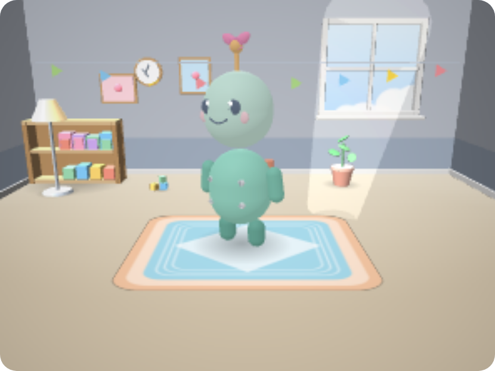

# 루미 (RooMi) — IC-PBL 프로토타입

> ㈜도로 × 한양대 IC-PBL 2026-2학기 · 인공지능학과
> 과제명: **아이들이 매일 다시 접속하고 싶은 DOROBUS 콘텐츠 개발**

**색칠해서 만든 로봇이 마이룸에 살면서, 매일 돌아올 이유를 만들어 주는 콘텐츠 모듈**

> **루미 = Room + Me** — 내 방(Room)에 사는 또 다른 나(Me)

🌐 **온라인 데모**: https://my-dorobot.app.workbuddy.host/
　 → 로그인 없이 **「🎬 데모 계정으로 바로 보기」** 를 누르면 7일치 사용 기록이 채워진 상태로 볼 수 있습니다.
🔧 **운영자 페이지**: `/admin.html` (헤더 `X-Admin-Key`, 배포 시 `ADMIN_KEY` 환경변수)



---

## 실행 방법 (로컬)

**방법 1 — macOS 더블클릭**: `start.command`

**방법 2 — 터미널**
```bash
cd <프로젝트 경로>
node --experimental-sqlite server.js
# → http://localhost:3000
```

의존성은 `express` 하나뿐입니다(`npm install`). DB는 Node 22 내장 SQLite(`node:sqlite`)이며
`roomi.db` 파일로 저장되고, 첫 실행 시 테이블과 시드 데이터가 자동 생성됩니다.

**배포 시 환경변수**
```bash
DB_PATH=<영구경로>/roomi.db \
ADMIN_KEY=<실제_관리자_키> \
node --experimental-sqlite server.js
```
> `ADMIN_KEY` 를 설정하지 않으면 관리자 API는 **503으로 차단**됩니다(의도된 안전장치).

---

## 핵심 기능

| 기능 | 내용 |
|---|---|
| **로봇 만들기** | 4종 템플릿 · 12색 팔레트 · 5개 부위 색칠 · 이름 짓기 → **+50셀 + 부품 1개** |
| **AI 성격 생성** | 색 조합 → 성격 6종(규칙) → LLM이 인사말·소개 생성 |
| **마이룸 (3D)** | Babylon.js 7. **리모델링 로봇**(큰 눈·관절·가슴 코어) · 침대/전구줄/커튼/그림자 · 자동 산책·대화·점프 · **오늘/방/성장 3탭** |
| **오늘의 AI 과제** | 매일 **이번 주 주제**에 맞는 질문 1개 → 답변 → 로봇 반응 (**+30셀**) |
| **미니게임 3종** | **버그 두더지**(30초 두더지잡기, 두더지 캐릭터·하늘/잔디 배경, +10~80셀) · **오늘의 퍼즐**(4지선다 3문제 + 연습 5문제 + 힌트 3개, +30셀) · **버그 슈터**(60초 슈팅, 우주/행성/로켓/벌레/보스 HP, +10~110셀) — 각 하루 1회 |
| **루미 대화** | 수다 / 같이 공부 / 마음 체크 3모드 · 최근 6턴 기억 · **기억 칩** · **한국어 목소리 선택/속도/음성 대화** · 학습 모드는 **L1/L2/L3 힌트** · «오늘의 한 줄» |
| **방 점등** | 학습 이해도(`understanding`)가 오르면 방 조명·책장이 밝아짐 |
| **AI 학습 계획** | 매일 3단계 계획(AI 생성/기본 폴백) · 계획 카드에서 바로 시작 · 3단계 완료 +10셀 |
| **AI 전용 기억** | 사용자별 `user_memories`(≤50) · 사실/선호/학습/목표/일정 · 채팅/계획/목표에 top6 주입 · 🧠 보기/삭제/«잊어줘» |
| **리텐션** | 주간 목표 3개 달성 시 **+30셀 수령** · **하루 쉰 연속 20셀 복구** · 미읽음 친구/우편 · **내일 예고** |
| **복습** | 틀린 문제를 **3일 뒤 복습 카드**로(+5셀) · 채팅 칩 «3일 전 틀린 문제» |
| **학습 설정·주간 목표** | 하루 시간/선호 시간/관심 주제/난이도 · AI가 주간 목표 3개·진행률 |
| **친구** | 6자리 코드 · 요청/수락 · 하루 1회 응원 · **친구 채팅**(200자·30통/일·개인정보/링크 차단) · **보호자 ON/OFF** · **신고/차단** |
| **보호자·접근성** | 보호자 1페이지 대시보드 · **이번 주 요약** · 글자 크기/색약 모드 · 음성 입력/읽어주기 · 주간 추천/주간 랭킹 |
| **상점** | 부품 · 방 장식 · 색칠 스킨(반복) · 부품 조각(**3개 → 1부품 교환**) · 주말 한정 |
| **성장** | Lv · 성장 단계(아기→청소년→성체, **3D 외형이 실제로 변함**) · 연속 방문 7일 순환 |
| **리포트** | 재접속률 · 체류시간 · 레벨 · 셀 흐름 · 최근 7일 추이 · **로봇 아바타 칩 클릭으로 진입** |
| **안전** | AI 출력 필터 · 보호자 승인 게이트 · 하루 40분 제한 · 계정 삭제 |
| **부가** | 효과음 · **셀 획득 +N/코인 애니메이션** · 오늘의 랭킹 · 자랑하기(그림 저장) · 첫 실행 온보딩 |
| **데모 모드** | 원클릭 데모 계정: Lv.5 · 계획 1/3 · 목표 3개(달성 보상) · 친구 2명(미읽음 3) · 우편 3통 · 책 6권 · 기억 6 · 복습 1 · 7일 리포트 |

---

## 데이터베이스 (21개 테이블)

| 분류 | 테이블 |
|---|---|
| 계정·성장 | `users` |
| 로봇 | `robots` · `robot_lines` |
| 경제 | `items` · `inventory` · `cell_tx` |
| 과제 | `daily_quests` · `quest_logs` |
| 미니게임 | `game_logs` |
| 접속·검증 | `visits` · `interact_logs` |
| 운영 | `weekly_topics` · `mailbox` · `class_logs` · `workshop_logs` |
| LLM·학습 | `chat_messages` · `learner_profile` · `knowledge_cards` · `learning_help_logs` · `llm_logs` |
| 시즌 | `seasons` |

- **`cell_tx`** — 모든 셀 증감을 기록 → 재화 흐름 추적
- **`visits`** — 재접속률·체류시간 검증 데이터 원천
- **`weekly_topics`** — 운영자가 주차별 주제를 등록 (미등록 시 도로랜드 챕터 자동 순환)

---

## API 요약

| 구분 | 엔드포인트 |
|---|---|
| 계정 | `POST /api/user` · `POST /api/user/delete` |
| 검증 | `POST /api/visit` · `/api/visit/duration` · `/api/visit/playtime` |
| 로봇 | `POST /api/robots` · `GET /api/robots/me` |
| 상호작용 | `POST /api/interact` |
| 과제 | `POST /api/quest/complete` · `POST /api/quest/answer` |
| 상점 | `GET /api/items` · `POST /api/shop/buy` · `POST /api/shop/exchange` · `GET /api/shop/exchange-info` |
| 미니게임 | `POST /api/game/result` |
| 성장 | `GET /api/growth/me` |
| 안전 | `GET /api/parent/quiz` · `POST /api/parent/verify` |
| 리포트 | `GET /api/board/me` · `GET /api/rank/daily` |
| 대화 | `POST /api/chat`(3모드) · `GET /api/chat/history` · `POST /api/chat/reset` |
| 방·퍼즐·시즌 | `GET /api/room/state` · `GET /api/puzzle/today` · `POST /api/puzzle/answer` · `GET /api/season/current` |
| 운영 | `GET /api/public/stats`(키 불필요) · `GET /api/admin/stats` · `GET /api/admin/export.csv` · `POST /api/admin/topic` · `POST /api/admin/mail` · `GET /api/admin/items` · `POST /api/admin/item` · `POST /api/admin/quest` · `POST /api/admin/season` |
| 데모 | `POST /api/demo/seed` |

---

## 효과 검증 지표

`GET /api/public/stats` — **개인정보 없는 집계값**(키 불필요)

| 지표 | 정의 |
|---|---|
| 재접속률 | `활동일수 ÷ 경과일수 × 100` (매일 접속하면 100%) |
| 체류시간 | 하루 **40분 상한**을 적용한 합계 (정책과 지표를 일치시킴) |
| 셀 사용량 | 상점 지출 합계 |
| 과제 제출 | 1인당 완료 과제 수 |

개별 데이터는 `GET /api/admin/export.csv?key=<ADMIN_KEY>` (엑셀 호환 BOM 포함).

---

## 기술 스택

| 계층 | 사용 |
|---|---|
| 프런트 | 순수 HTML/CSS/JS (프레임워크 없음) · Babylon.js 7 (CDN) |
| 백엔드 | Node.js 22 · Express 5 · 내장 SQLite |
| AI | **DeepSeek 단일(`deepseek-chat`, 비추론)** → 예비 대사 |
| 3D | 절차적 메시 생성 (외부 모델 파일 없음) |

> 회사 스택(Babylon.js · Node/Express)과 동일 계열로 맞췄습니다.

---

## 문서

| 문서 | 내용 |
|---|---|
| `docs/기능기획서.md` | 기능 정의 · 연결점 · 평가 5차원 자기점검 |
| `docs/사례조사-보고서.md` | Duolingo · Roblox · ZEP 분석과 설계 원칙 |
| `docs/효과검증-계획과보고서.md` | 지표 정의 · 실험 설계 · 결과 양식 |
| `docs/운영자가이드.md` | 아이템·과제·주제·대사 관리 방법 |
| `docs/HWP양식-작성가이드.md` | 학교 제출 양식 7종 작성 안내 |
| `docs/기업연결점-확인요청.md` | 기업 담당자 확인 요청서 |
| `docs/1-사용흐름도.svg` · `2-셀흐름도.svg` · `3-와이어프레임.svg` | 도면 3종 |
| `docs/기술스택-적응방안.md` | 회사 스택 이식 3안 · 레이어별 치환표 · 4단계 계획 |
| `docs/과제수행계획서.md` | PBL 4분면 과제수행계획서 |
| `docs/技术文档.md` | 21 表 · 49 API · DeepSeek 단일 · 변경 기록 |
| `docs/ui-refactor/` | UI 3.0 스크린샷 9장 (시작/마이룸/만들기/상점/대화/리포트/공작소/우편함/모바일) |
| `docs/演示-1页flow与奖励表.md` | 演示 1 页 flow + 셀 보상표 |
| `docs/HWP양식-docx/` | HWP 7종 DOCX 사본(붙여넣기용) |
| `scripts/eval_chat.mjs` | 50문항 대화 평가 하네스 |
