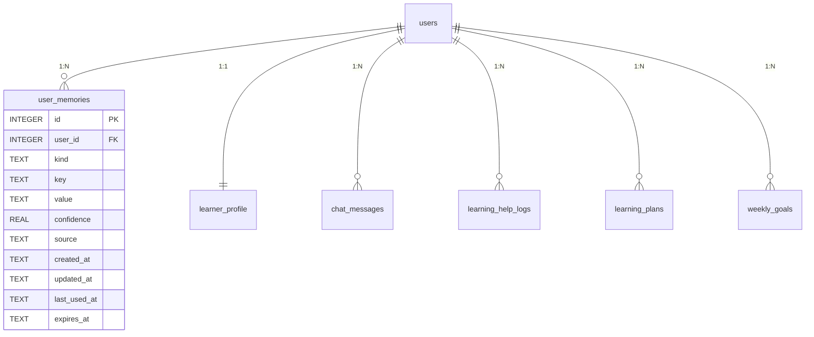
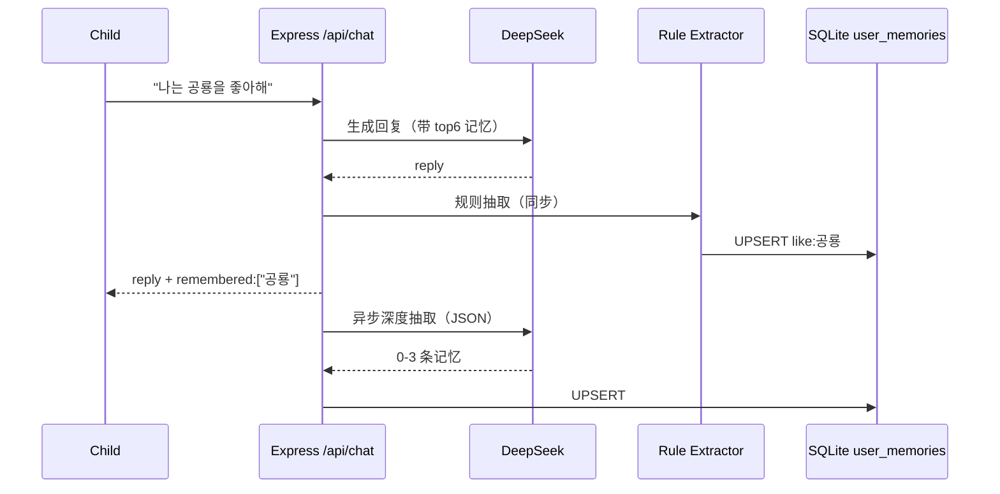

# AI 专属记忆 — 数据库设计与实现记录

> **项目**：루미 (RooMi) — 儿童机器人学习伙伴  
> **主题**：每个用户一条独立的 AI 长期记忆链  
> **用途**：数据库课程期末发表 / 答辩材料  
> **版本**：v1.0 / 2026-10-31  
> **对应代码**：`server.js`、`public/app.js`、`public/index.html`、`public/style.css`

---

## 1. 一句话概括

> 不是把聊天记录全部塞给 AI，而是把每轮对话**蒸馏**成稳定的“事实 / 偏好 / 学习状态 / 目标 / 日程”，存进每个用户自己的 `user_memories` 表；下一轮只召回最相关的 top 6 注入 system prompt。

```
对话 → 规则/LLM 抽取 → 去重合并(UPSERT) → user_memories
     → 关键词+置信度+最近使用 召回 top 6 → 注入 prompt → 回复
```

---

## 2. 需求分析

### 2.1 功能需求

| 编号 | 需求 | 实现 |
|---|---|---|
| F1 | 记住孩子说过的事实/喜好 | `fact`，如“공룡과 BTS” |
| F2 | 记住解释方式偏好 | `preference`，如“비유를 좋아함” |
| F3 | 记住学习状态（会/不会） | `learning`，如“변수 이해 / 반복문 어려움” |
| F4 | 记住本周目标 | `goal`，如“퍼즐 2회” |
| F5 | 记住短期日程 | `event`，带 `expires_at` |
| F6 | 记忆影响聊天和计划 | 聊天/计划/目标 prompt 注入 |
| F7 | 孩子可查看/删除记忆 | 🧠 记忆弹窗 + 单条删除 + 全部清空 |
| F8 | 说“잊어줘”可遗忘 | `/api/chat` 固定分支 |
| F9 | 家长可查看/删除 | 家长 dashboard → AI 기억 보기 |

### 2.2 非功能需求

| 指标 | 目标 | 实现 |
|---|---|---|
| 隔离 | 每个用户只能读写自己的记忆 | 所有查询带 `user_id` + `X-Token` |
| 延迟 | 不拖慢聊天回复 | 规则抽取同步、LLM 抽取异步 |
| 容量 | 单用户最多 50 条 | 超出淘汰最低置信度/最旧 |
| 隐私 | 不存电话/地址/邮箱/学校 | `hasContactInfo()` + `isSafeText()` |
| 可解释 | 家长/孩子能看到 AI 记了什么 | 记忆卡片 + 置信度 + key |
| 可撤销 | 可单条/全部删除 | `DELETE /api/memory/:id`、`DELETE /api/memory` |

---

## 3. 为什么“记忆”不等于“聊天记录”

| 维度 | `chat_messages` | `user_memories` |
|---|---|---|
| 内容 | 原始对话 | 蒸馏后的事实/偏好/学习状态 |
| 数量 | 会无限增长 | 最多 50 条/用户 |
| 用途 | 最近 6 轮上下文 | 长期个性化 |
| 查询 | 按时间 | 按 kind/key/置信度/关键词 |
| 删除 | 清空聊天 | 可单条遗忘 |
| Token | 多轮会爆 | top 6 可控 |

聊天记录回答“刚才说了什么”；记忆回答“这个孩子是谁、学到哪、喜欢怎么学”。

---

## 4. 数据库设计

### 4.1 ERD（逻辑关系）



> SQLite 中外键默认不强制；本项目用应用层 `user_id` + `X-Token` 双重校验保证隔离。ERD 中的 FK 为逻辑外键。

### 4.2 建表 SQL

```sql
CREATE TABLE IF NOT EXISTS user_memories(
  id INTEGER PRIMARY KEY AUTOINCREMENT,
  user_id INTEGER NOT NULL,
  kind TEXT NOT NULL,
  key TEXT NOT NULL,
  value TEXT NOT NULL,
  confidence REAL NOT NULL DEFAULT 0.7,
  source TEXT DEFAULT 'chat',
  created_at TEXT DEFAULT (datetime('now','+9 hours')),
  updated_at TEXT DEFAULT (datetime('now','+9 hours')),
  last_used_at TEXT,
  expires_at TEXT,
  UNIQUE(user_id, kind, key)
);

CREATE INDEX IF NOT EXISTS idx_mem_user
  ON user_memories(user_id, kind);
```

### 4.3 字段说明

| 字段 | 类型 | 说明 |
|---|---|---|
| `id` | INTEGER PK | 自增主键 |
| `user_id` | INTEGER | 所属用户；所有查询第一条件 |
| `kind` | TEXT | `fact` / `preference` / `learning` / `goal` / `event` |
| `key` | TEXT | 记忆的稳定标识，如 `like:공룡`、`weak:반복문` |
| `value` | TEXT | 给人看的短句，≤60 字 |
| `confidence` | REAL | 0.1–1.0，冲突时取 MAX |
| `source` | TEXT | `chat` / `manual` / `demo` |
| `created_at` | TEXT | 首次写入（KST） |
| `updated_at` | TEXT | 最近更新 |
| `last_used_at` | TEXT | 最近被召回；用于排序/淘汰 |
| `expires_at` | TEXT | 可选 TTL；`event` 用它 |

### 4.4 约束与索引

| 对象 | 作用 |
|---|---|
| `PRIMARY KEY(id)` | 唯一行标识 |
| `UNIQUE(user_id, kind, key)` | **UPSERT 的核心**：同一用户同一类同一 key 只保留一条 |
| `INDEX(user_id, kind)` | 加速“某用户某类记忆”查询与 50 条上限统计 |
| `expires_at` | 查询时过滤过期日程，不物理删除也可 |

### 4.5 规范化分析

- **1NF**：`value` 为原子短句，不把多个喜好塞进数组。
- **2NF**：主键是单列 `id`，不存在部分依赖。
- **3NF**：`kind/key/value/confidence` 直接依赖 `id`；`user_id` 只表示归属，不传递依赖其他非键字段。
- **为什么不用一个 JSON 列**：
  - JSON 无法用 `UNIQUE(user_id,kind,key)` 做原子 UPSERT；
  - 无法对单条记忆做索引/删除/TTL；
  - 50 条上限与“遗忘”需要行级操作；
  - 课程展示中，行式表更能体现主键、唯一约束、索引、UPSERT。

---

## 5. 写入流程（Write Path）

### 5.1 时序



### 5.2 规则抽取（同步，立即可见）

| 模式 | 例子 | kind | key |
|---|---|---|---|
| `X 좋아해` | 나는 공룡을 좋아해 | fact | `like:공룡` |
| `X 어려워` | 반복문이 어려워 | learning | `weak:반복문` |
| `X 이해했` | 변수를 이해했어 | learning | `understood:변수` |
| `시험/숙제/발표` | 다음 주 시험 | event | `event:YYYY-MM-DD` |

- 去掉“나는/내가/저는/제가”和末尾助词（을/를/이/가/은/는）。
- 过滤敏感信息（电话/邮箱/URL/6 位以上数字）。
- 同步写入，所以聊天返回里能立即带 `remembered:["공룡"]`。

### 5.3 LLM 深度抽取（异步）

Prompt 约束：

```text
只抽取 0–3 条“长期有价值”的记忆：
fact / preference / learning / goal / event
排除：临时情绪、闲聊、电话/地址/邮箱/学校
key 用短英文/韩文 snake_case，value ≤30 字
只输出 JSON: {"memories":[{"kind":"...","key":"...","value":"...","confidence":0.0}]}
```

- 在 `res.json()` 之后用 `setImmediate()` 执行，不增加孩子等待。
- 失败/无 key 时静默跳过，规则抽取仍然有效。

### 5.4 UPSERT（核心 SQL）

```sql
INSERT INTO user_memories(user_id, kind, key, value, confidence, source, expires_at)
VALUES (?, ?, ?, ?, ?, ?, ?)
ON CONFLICT(user_id, kind, key) DO UPDATE SET
  value = excluded.value,
  confidence = MAX(user_memories.confidence, excluded.confidence),
  source = excluded.source,
  updated_at = datetime('now','+9 hours');
```

- 同一 `key` 不新增行，而是更新 value/置信度/时间。
- 置信度取 MAX，避免一次低置信度覆盖高置信度。
- 这是 SQLite 的 UPSERT 语法，等价于“先 SELECT 再 UPDATE/INSERT”但原子性更好。

### 5.5 50 条上限与淘汰

```sql
SELECT COUNT(*) FROM user_memories WHERE user_id = ?;

DELETE FROM user_memories
WHERE id = (
  SELECT id FROM user_memories
  WHERE user_id = ?
  ORDER BY confidence ASC, updated_at ASC, id ASC
  LIMIT 1
);
```

- 新 key 且已满 50 条 → 淘汰“置信度最低 + 最久未更新”的一条。
- 已存在的 key 更新不受上限影响。

---

## 6. 读取流程（Read Path）

### 6.1 召回算法

```text
score = confidence
      + 3 × (query 关键词命中 key/value)
      + 1.0 if kind = learning
      + 0.6 if kind = preference
      + 0.4 if kind = goal
```

- 取 score 最高的 **top 6**。
- 对被选中的行更新 `last_used_at`。
- 关键词按韩文/英文/数字切分，长度 ≥2。

### 6.2 注入 Prompt

```text
[루미가 기억하는 것]
- 사실/like:공룡: 공룡
- 偏好/explain_style: 비유로 설명해 주면 잘 이해해
- 학습/weak:반복문: 반복문 어려움
- 목표/weekly_puzzle: 이번 주 퍼즐 2회
```

- 只注入 6 条，约 100–200 token。
- 聊天、每日计划、每周目标三处共用同一个 `memoryPrompt()`。
- 计划/目标 prompt 里增加 `- 기억:` 段，AI 会据此调整难度/主题/时间。

### 6.3 聊天中的“잊어줘”

`/api/chat` 在调用 LLM 前拦截：

| 输入 | 行为 |
|---|---|
| `BTS 잊어줘` | 删除 key/value 含“BTS”的记忆 |
| `잊어줘` | 不删除，回复“무엇을 잊을까? 'BTS 잊어줘'처럼 말해 줘.” |
| `기억하지 마` | 同“잊어줘” |

固定回复不经过 LLM，避免 AI 编造“已经忘了”。

---

## 7. API 设计

| 方法 | 路径 | 鉴权 | 作用 |
|---|---|---|---|
| GET | `/api/memory` | X-Token | 当前用户全部有效记忆 |
| POST | `/api/memory` | X-Token | 手动新增/更新（家长/孩子） |
| DELETE | `/api/memory/:id` | X-Token | 删除单条（带 user_id 校验） |
| DELETE | `/api/memory` | X-Token | 清空当前用户全部记忆 |

### 7.1 示例

```http
GET /api/memory
X-Token: <token>
```

```json
{
  "ok": true,
  "count": 6,
  "memories": [
    {
      "id": 3,
      "kind": "learning",
      "key": "weak:반복문",
      "value": "반복문이 어려움",
      "confidence": 0.8,
      "source": "demo",
      "updated_at": "2026-10-31 12:00:00",
      "last_used_at": null,
      "expires_at": null
    }
  ]
}
```

```http
DELETE /api/memory/3
X-Token: <token>
```

```json
{ "ok": true, "memories": [ ... ] }
```

---

## 8. 前端交互

| 位置 | 功能 |
|---|---|
| 聊天头部 🧠 | 打开“루미의 기억”弹窗 |
| 记忆弹窗 | 6 类卡片、kind 标签、置信度、单条删除 |
| 弹窗底部 | 选择 kind + 输入 + “기억시키기” |
| “모두 잊어줘” | 确认后清空 |
| 聊天回复 | `🧠 루미가 기억했어: 공룡` toast |
| 家长 dashboard | “🧠 AI 기억 보기”按钮 |
| 聊天输入 | “BTS 잊어줘”固定遗忘 |

### 8.1 截图

- `docs/ui-refactor/41-memory-modal.png` — 记忆弹窗（6 条）
- `docs/ui-refactor/42-memory-after.png` — 手动新增后
- （可选）聊天 toast / 家长入口

---

## 9. 安全与隐私

| 风险 | 措施 |
|---|---|
| 跨用户读取 | 所有 SQL 带 `user_id`；Token 校验；删除时 `WHERE id=? AND user_id=?` |
| 敏感信息入库 | `isSafeText()` + `hasContactInfo()`（电话/邮箱/URL/6 位数字） |
| 记忆过多/过时 | 50 条上限 + `expires_at` + 低置信度淘汰 |
| 孩子无法撤销 | 弹窗单条删除 + 全部清空 + “잊어줘” |
| 家长不知情 | 家长 dashboard 可查看/删除 |
| LLM 乱编“已忘” | “잊어줘”走固定分支，不调用 LLM |
| 把聊天原文当记忆 | 只存蒸馏短句，不存整段对话 |

---

## 10. 与数据库课程知识点对应

| 课程知识点 | 在本项目中的体现 |
|---|---|
| 主键 | `user_memories.id AUTOINCREMENT` |
| 逻辑外键 | `user_id → users.id`，应用层校验 |
| 唯一约束 | `UNIQUE(user_id, kind, key)` 支撑 UPSERT |
| 索引 | `idx_mem_user(user_id, kind)` |
| 规范化 | 1NF/2NF/3NF；不用 JSON 大字段 |
| UPSERT | `ON CONFLICT ... DO UPDATE` |
| 原子性 | 单条 UPSERT 原子；无需显式事务 |
| 查询优化 | 先按 user_id 过滤，再排序；50 条上限 |
| 数据保留 | `expires_at` TTL；过期不返回 |
| 隔离性 | 每个查询都带 user_id，Token 绑定会话 |
| 数据清洗 | 规则 + LLM + 敏感信息过滤 |

### 10.1 可现场执行的 SQL

```sql
-- 1) 某用户的全部记忆
SELECT kind, key, value, confidence
FROM user_memories
WHERE user_id = ?
ORDER BY updated_at DESC;

-- 2) 某类记忆数量
SELECT kind, COUNT(*) AS cnt
FROM user_memories
WHERE user_id = ?
GROUP BY kind;

-- 3) 最该淘汰的记忆
SELECT id, kind, key, confidence, updated_at
FROM user_memories
WHERE user_id = ?
ORDER BY confidence ASC, updated_at ASC
LIMIT 1;

-- 4) 查看某条记忆被召回的情况
SELECT key, value, last_used_at
FROM user_memories
WHERE user_id = ? AND last_used_at IS NOT NULL
ORDER BY last_used_at DESC;
```

---

## 11. 期末发表演示脚本（约 5 分钟）

### 0:00–0:40 开场

> “AI 聊天通常是无状态的。我们给每个孩子做了一条独立的记忆链：不是保存全部聊天，而是把对话蒸馏成事实、偏好、学习状态、目标和日程。”

### 0:40–1:40 写入演示

1. 点「🎬 데모 계정으로 바로 보기」。
2. 打开聊天，输入：`나는 공룡을 좋아해`。
3. 出现 toast：`🧠 루미가 기억했어: 공룡`。
4. 点聊天头部 🧠，展示 `사실 / like:공룡`。

### 1:40–2:40 读取演示

1. 再问：`내가 뭘 좋아하는지 알아?`
2. 说明：AI 的 system prompt 里注入了 `[루미가 기억하는 것]`，所以它能答出“공룡”。
3. 展示 `user_memories` 表 / SQL 查询结果。

### 2:40–3:30 遗忘演示

1. 输入：`BTS 잊어줘`。
2. 回复：`"BTS" 기억은 지웠어. 다른 기억은 그대로야.`
3. 再打开 🧠，确认 BTS 消失，其他记忆保留。

### 3:30–4:20 数据库设计讲解

- 展示 ERD：`users 1:N user_memories`。
- 强调 `UNIQUE(user_id, kind, key)` 与 UPSERT。
- 展示 `idx_mem_user` 与 50 条上限 SQL。
- 说明为什么不用 JSON 列。

### 4:20–5:00 隐私与扩展

- 每用户隔离；敏感信息过滤；TTL；家长可查看/删除。
- 未来：embedding 召回、记忆冲突合并、记忆摘要、家长导出。

---

## 12. 测试记录

### 12.1 API

| 测试 | 结果 |
|---|---|
| `GET /api/memory` 新用户 | `count: 0` |
| `POST /api/memory` 手动新增 | 200，列表新增 |
| 聊天“나는 공룡을 좋아해” | `remembered: ["공룡"]` |
| 聊天“반복문이 어려워” | `remembered: ["반복문 어려움"]` |
| `BTS 잊어줘` | 删除 BTS，其他保留 |
| `DELETE /api/memory/:id` | 200，列表减少 |
| `DELETE /api/memory` | 200，清空 |
| Demo seed | 6 条记忆（fact/preference/learning×2/goal/event） |
| 表数量 | 31（含 `goal_claims`/`review_cards`） |
| API 数量 | 75 |

### 12.2 UI

| 测试 | 结果 |
|---|---|
| 聊天 🧠 打开记忆弹窗 | 6 条卡片 |
| 单条删除 | 6 → 5 |
| 手动新增“우주를 좋아해” | 5 → 6 |
| 聊天“나는 공룡을 좋아해” | toast `🧠 루미가 기억했어: 공룡` |
| 家长 dashboard「AI 기억 보기」 | 弹窗打开 |
| JS 错误 | 0 |

---

## 13. 代码位置

| 功能 | 文件 / 函数 |
|---|---|
| 建表 | `server.js` → `CREATE TABLE user_memories` |
| 写入/合并 | `upsertMemory()` |
| 列表 | `listMemories()` |
| 召回 | `retrieveMemories()` |
| Prompt | `memoryPrompt()` |
| 规则抽取 | `extractMemoryRules()` |
| LLM 抽取 | `extractMemoryLLM()` |
| 遗忘 | `forgetMemories()` |
| API | `/api/memory` 四个路由 |
| 聊天注入 | `/api/chat` 中 `mems/memText` |
| 计划/目标注入 | `generatePlan()` / `generateGoals()` 中 `memTextPlan` / `memTextGoal` |
| 前端 | `loadMemories()` / `renderMemories()` / `deleteMemory()` / `addMemory()` / `clearMemories()` |
| UI | `#chat-memory`、`#memory-modal`、`#memory-list` |
| Demo | `/api/demo/seed` 中 `demoMems` |

---

## 14. 限制与后续扩展

| 限制 | 后续 |
|---|---|
| 关键词召回，不是语义召回 | 数据量 >200 条时加 `sqlite-vec` / embedding |
| LLM 抽取异步，可能晚一轮可见 | 关键事实用规则同步兜底；可加“记忆队列” |
| 同类 key 冲突覆盖 | 可加 `history_json` 或版本表 |
| 没有记忆摘要 | 每周把 50 条压成 10 条“长期画像” |
| 家长只能看/删 | 可加“家长备注/禁用某类记忆” |
| 没有跨设备同步 | 记忆在服务端，天然随账号同步 |

---

## 15. 结论

- 每个用户的 AI 记忆 = **一张按 user_id 隔离的表 + 一套抽取/召回/注入流程**。
- 数据量小（≤50 条）时，关键词 + 置信度 + 最近使用足够，不需要向量库。
- 数据库设计的三个关键点：
  1. `UNIQUE(user_id, kind, key)` 支撑 UPSERT，避免重复；
  2. `INDEX(user_id, kind)` 支撑按用户/类型查询；
  3. `expires_at` + 50 条上限 + 单条删除，保证记忆可控制、可遗忘。
- 对孩子：AI 更懂自己；对家长：可查看/可删除；对课程：主键、唯一约束、索引、UPSERT、规范化、TTL 都有真实落点。

---

*文档结束。演示时建议同时打开：Demo 账号 → 聊天 🧠 → 家长 dashboard → `user_memories` SQL 查询。*
