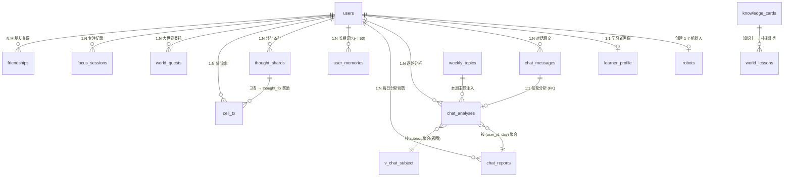

# RooMi 数据库设计说明书（全量 46 张表）

> **Version 1.0 / 2026-11-09 · 对应代码 `server.js` v1.40**
> 适用：数据库课程期末发表 / 答辩 / 代码交接
> 证据来源：**运行中的 SQLite `sqlite_master` 原文**（`GET /api/chat/analysis/schema` 可在线上直接取回同一份 DDL）
> 规模：**46 张表 · 1 个视图 · 26 条显式索引 · 112 个 API**
> 关联文档：`docs/기술문서.md` §14、`docs/AI专属记忆-数据库设计-期末发表.md`（单表深挖）、`docs/11-ER-최종.svg`（旧版 32 表 ER 图，已被本文覆盖）

---

## 0. 一句话

> **孩子和 AI 说的每一句话都先原样落库，再由确定性规则逐轮分析成可查询的学习信号；整套产品 46 张表的设计、约束、关系与保留策略在本文逐表列全。**

本次需求拆解（教授反馈「要保存和 AI 聊天的内容然后分析，所有内容要有数据库设计」）：

| # | 要求 | 交付 |
|---|---|---|
| R1 | **保存**和 AI 的聊天内容 | `chat_messages` 已存 user/assistant 全文；v1.40 把分散的 4 处 INSERT 收敛为唯一入口 `saveChatTurn()`，结构上杜绝「存了却漏掉」 |
| R2 | 对聊天内容做**分析** | 新增 `chat_analyses`（逐轮）+ `chat_reports`（按日）+ `v_chat_subject`（SQL 视图）+ 4 个分析 API + 报告页 UI |
| R3 | **所有内容要有数据库设计** | 本文：46 张表逐表字段/约束、8 个域分组、ER 图、索引、范式、隐私与保留策略、全量 DDL 附录 |

---

## 1. 设计目标与约束

| 维度 | 目标 | 落地方式 |
|---|---|---|
| 完整性 | 每条 AI 对话都能追溯到原文 | `chat_analyses.user_msg_id → chat_messages.id`（FK），`UNIQUE(user_msg_id)` 保证 1 轮 1 分析 |
| 隔离性 | 一个孩子绝不能读到另一个孩子的数据 | 所有 API 以 `X-Token → users.id` 鉴权；每条 SELECT/DELETE 都带 `user_id` 条件 |
| 可复现 | 同样的对话必须得到同样的分析 | **确定性规则引擎**，不把孩子的话再丢给 LLM 评判（零成本、零延迟、可写单测） |
| 幂等 | 回填/重试不能把数字越滚越大 | `chat_reports` 用「按现有分析行重新聚合 + UPSERT」，不做 `turns = turns + 1` |
| 最小必要 | 儿童产品少存、少留 | 原文 30 天自动清理；`llm_logs` 不存正文；`isSafeText()` 拦电话/账号/链接 |
| 可解释 | 家长/孩子/评审能看见数据库长什么样 | `/api/chat/analysis/schema` 直接返回 `sqlite_master` 真实 DDL，报告页可展开 |

---

## 2. 概念模型（ER）



**域分组总览**（8 组，覆盖 46 张表）：

| 组 | 域 | 表数 | 代表表 |
|---|---|---|---|
| A | 用户与身份 | 6 | `users` `robots` `learner_profile` |
| B | AI 对话 · 分析 · 记忆 | 6 | `chat_messages` `chat_analyses` `chat_reports` `user_memories` |
| C | 学习内容与计划 | 9 | `knowledge_cards` `learning_plans` `review_cards` |
| D | 经济 · 道具 · 邮件 | 6 | `cell_tx` `items` `inventory` |
| E | 大世界与游戏日志 | 9 | `village_props` `world_quests` `world_presence` |
| F | 朋友与社区 | 6 | `friendships` `friend_messages` `guestbook` |
| G | 留存与状态 | 3 | `nudges` `mood_logs` `focus_sessions` |
| H | 自己的想法（v1.39） | 1 | `thought_shards` |

---

## 2.5 聊天分析子系统（本次新增，重点）

### 2.5.1 需求 → 概念 → 逻辑 → 物理

| 层次 | 内容 |
|---|---|
| 需求 | 保存与 AI 的全部聊天；能回答「孩子这周问了什么、哪里卡住、情绪怎样、AI 给了多少提示」 |
| 概念 | 实体：`对话原文(turn)`、`逐轮分析(analysis)`、`每日报告(report)`；关系：1 轮 → 1 分析，N 分析 → 1 日报 |
| 逻辑 | `chat_messages(id, user_id, role, content, mode, hint_level, follow_up, ts)`；`chat_analyses(..., user_msg_id FK UNIQUE, ai_msg_id, subject, intent, sentiment, stuck, solved, keywords, ...)`；`chat_reports(user_id, day UNIQUE, turns, stuck_count, ..., summary)` |
| 物理 | `idx_chat_user_ts(user_id, ts)` 支撑历史拉取；`idx_ca_user_day(user_id, day)` 支撑周报；`idx_ca_subject(user_id, subject)` 支撑主题分布；`v_chat_subject` 视图避免再存一份聚合表 |

### 2.5.2 数据流

```
POST /api/chat (4 个分支: 일반 / 잊어줘 / 누가만들었어 / LLM)
        │
        ▼  saveChatTurn()  ← 全项目唯一写入 chat_messages 的地方
  ① INSERT user 消息 ──► chat_messages.id
  ② INSERT assistant 消息 ──► chat_messages.id
  ③ analyzeChatText() 确定性规则 → 16 个特征
  ④ INSERT OR IGNORE chat_analyses (user_msg_id, ai_msg_id, ...)
  ⑤ 按 (user_id, day) 重新聚合 → UPSERT chat_reports
        │
        ▼  조회
  GET /api/chat/analysis           日报 + 周趋势 + 主题(뷰) + intent 分布 + 커버리지
  GET /api/chat/analysis/messages  chat_analyses ⋈ chat_messages (원문 JOIN)
  GET /api/chat/analysis/schema    sqlite_master 실제 DDL
  POST /api/chat/analysis/rebuild  과거 대화 소급 분석 (멱등)
  POST /api/chat/reset             원문 + 분석 + 리포트 동시 삭제
```

### 2.5.3 分析维度与规则（不调用 LLM）

| 字段 | 取值 | 判定 |
|---|---|---|
| `subject` | 수학 / 코딩 / 과학 / 언어 / 로봇·마을 / 일상 | 有序关键词正则，首个命中 |
| `intent` | 인사 / 힌트 요청 / 마음 표현 / 복습 / 질문 / 이야기 | 有序关键词正则 |
| `sentiment` | 밝음 / 보통 / 힘듦 | 消极词优先于积极词（儿童表达「힘들지만 재밌어」判为 힘듦，避免漏掉需要帮助的信号） |
| `stuck` | 0 / 1 | `모르겠 / 어렵 / 막혔 / 틀렸 / 헷갈 / 포기 / …` |
| `solved` | 0 / 1 | 来自 `/api/chat` 的 `solved` 判定 |
| `word_count` / `question_count` | 整数 | 孩子表达长度、提问次数 |
| `reply_has_hint` / `reply_has_praise` | 0 / 1 | 对 **AI 回复**也做分析，回答「루미가 힌트를 줬는가 / 칭찬했는가」 |
| `keywords` | 逗号串（≤5） | 命中词去重，用于「자주 막히는 지점」 |

### 2.5.4 为什么这样设计（可答辩的取舍）

1. **原文与分析分表**：规则会迭代，原文不能跟着改。分表后可随时 `rebuild`，且 `chat_messages` 保持窄表、历史查询快。
2. **1 轮 1 行 + `UNIQUE(user_msg_id)`**：数据库层面防重复分析，比应用层 `if` 可靠。
3. **日报表是物化聚合，主题分布却是视图**：日报每天被读多次且要生成 `summary` 文本 → 存；主题分布只是 `GROUP BY` → 用视图，避免冗余与不一致。这是有意的「部分反范式」。
4. **分析不交给 LLM**：儿童产品的「情绪/卡住」判断若交给 LLM，既不可复现又有内容风险；规则引擎可用单元测试逐条断言。
5. **reset 三表同删**：否则会出现「原文已删、分析还在」的孤儿行，正是外键约束想防的情况。
6. **不启用 SQLite 级联删除**：`PRAGMA foreign_keys` 状态在不同运行环境不一致，因此删除顺序由应用层显式保证（分析 → 报告 → 原文），FK 只作设计文档与 `sqlite_master` 的完整性声明。

---

## 3. 完整性约束与索引策略

| 类型 | 例子 | 作用 |
|---|---|---|
| 主键 | 全部表 `INTEGER PRIMARY KEY AUTOINCREMENT`（`world_presence` / `learner_profile` 用业务主键） | 稳定行标识 |
| 外键 | `chat_analyses.user_msg_id → chat_messages.id` | 分析结果必须能追到原文 |
| 唯一 | `(user_id, day)` in `chat_reports`、`user_msg_id`、`(user_id, key)` in `user_memories` / `village_props` / `world_secrets` | 幂等、防重复领奖、防重复记忆 |
| 索引 | `idx_chat_user_ts` / `idx_ca_user_day` / `idx_ca_subject` / `idx_mem_user` / `idx_review_due` …（共 26 条） | 都从「按用户 + 按时间/键」的真实查询模式倒推，不做无谓索引 |
| 默认值 | `ts = datetime('now','+9 hours')` | KST 统一日界，部署环境时区无关 |
| 视图 | `v_chat_subject` | 主题分布实时聚合，无冗余存储 |

---

## 4. 范式与反范式

- **3NF 为主**：用户、商品、日志、关系各自独立，无传递依赖；`cell_tx` 是셀 的唯一事实来源，余额由流水累加。
- **有意的反范式**：
  - `users.cell_balance` 冗余于 `cell_tx` 求和 → 换取首屏零聚合查询，由 `grantCell()` 在同一函数内双写保证一致。
  - `chat_reports` 冗余于 `chat_analyses` 聚合 → 换取日报 O(1) 读取，由「重新聚合 + UPSERT」保证幂等。
  - `users.understanding` 与 `learner_profile.understanding` 双写 → 兼容历史代码路径，`profileFor()` 以 learner_profile 为准。
- **软删除 vs 硬删除**：儿童产品以「最小留存」为原则，聊天采用 30 天硬删除；`forgetMemories()` 支持按条删除，符合「可遗忘权」演示需求。

---

## 5. 隐私、隔离与运维

| 项 | 策略 |
|---|---|
| 鉴权 | `X-Token → users.token`，服务端不信任客户端传来的 `user_id` |
| 行级隔离 | 每个查询都带 `user_id`；朋友坐标 (`world_presence`) 只在服务端校验 `friendships.status='accepted'` 后下发 |
| 输入过滤 | `isSafeText()` 拦 6+ 位数字、电话/账号/链接、成人/暴力词，长度 ≤200 |
| 内容最小化 | `llm_logs` 只存 model/latency/ok，不存对话正文 |
| 保留 | 对话原文与对应分析 30 天；启动时清理 `chat_messages`，`reset` 同步清三表 |
| 备份 | 部署用 `DB_PATH=/tmp/dorobot-online.db`（沙箱持久目录）；本地开发 `roomi.db`；迁移靠 `CREATE TABLE IF NOT EXISTS` + `try { ALTER TABLE } catch {}` |

---

## 6. 期末发表「问题 → 设计 → 实现 → 证据」

| 问题 | 设计 | 实现 | 证据 |
|---|---|---|---|
| 聊天只被计数，没被理解 | 原文 / 逐轮分析 / 日报三层 | `chat_messages` + `chat_analyses` + `chat_reports` + `v_chat_subject` | 本文 §2.5、`/api/chat/analysis/schema` 真实 DDL |
| 担心「存了但漏分析」 | 单一写入口 + DB 唯一约束 | `saveChatTurn()`（全项目仅 1 处 `INSERT INTO chat_messages`）、`UNIQUE(user_msg_id)` | `coverage.user_msgs === coverage.analyzed`（线上实测 4/4） |
| 分析结果不可复现 | 确定性规则，不用 LLM 评判 | `analyzeChatText()` 16 特征 | 分수→수학/막힘、코딩→코딩/막힘 单测 PASS |
| 报告要能给孩子和家长看 | 리포트 面板 + 逐轮明细 + DDL 展开 | `#ca-panel` / `#chat-analysis-modal` / `#ca-ddl` | 리포트 스크린샷 |
| 「所有内容要有数据库设计」 | 46 表逐表字段 + ER + 全量 DDL | 本文档（由 `sqlite_master` 自动生成） | §7 逐表定义 + 附录 A |

---

## 7. 逻辑设计 — 46 张表逐表定义

> 下表**由运行中的 SQLite `sqlite_master` 自动生成**，字段与约束和线上代码一一对应；
> 「用途」为人工标注。PK / FK / UNIQUE / DEFAULT 均按真实 DDL 记录。

### A. 用户与身份

#### `users` — 账号主表：token、等级、经验、连续访问、셀 잔액、이해도

| 列 | 类型 / 约束 |
|---|---|
| `id` | `INTEGER PRIMARY KEY AUTOINCREMENT` |
| `nickname` | `TEXT UNIQUE NOT NULL` |
| `cell_balance` | `INTEGER NOT NULL DEFAULT 0` |
| `created_at` | `TEXT DEFAULT (datetime('now','+9 hours'))` |
| `friend_code` | `TEXT` |
| `token` | `TEXT` |
| `level` | `INTEGER NOT NULL DEFAULT 1` |
| `exp` | `INTEGER NOT NULL DEFAULT 0` |
| `streak` | `INTEGER NOT NULL DEFAULT 0` |
| `last_visit` | `TEXT` |
| `revive_streak` | `INTEGER` |
| `revive_until` | `TEXT` |
| `parent_ok` | `INTEGER NOT NULL DEFAULT 0` |
| `play_minutes` | `INTEGER NOT NULL DEFAULT 0` |
| `play_bonus` | `INTEGER NOT NULL DEFAULT 0` |
| `play_day` | `TEXT` |
| `understanding` | `INTEGER NOT NULL DEFAULT 0` |

#### `robots` — 孩子创建的机器人（模板 / 调色 / 性格 / 问候语）

| 列 | 类型 / 约束 |
|---|---|
| `id` | `INTEGER PRIMARY KEY AUTOINCREMENT` |
| `user_id` | `INTEGER NOT NULL REFERENCES users(id)` |
| `name` | `TEXT NOT NULL` |
| `template` | `TEXT NOT NULL` |
| `palette` | `TEXT NOT NULL` |
| `personality` | `TEXT NOT NULL` |
| `greeting` | `TEXT NOT NULL` |
| `created_at` | `TEXT DEFAULT (datetime('now','+9 hours'))` |

#### `robot_lines` — 机器人台词池，按性格取用

| 列 | 类型 / 约束 |
|---|---|
| `id` | `INTEGER PRIMARY KEY AUTOINCREMENT` |
| `personality` | `TEXT NOT NULL` |
| `situation` | `TEXT NOT NULL` |
| `line` | `TEXT NOT NULL` |

#### `learner_profile` — 学习者长期画像：이해도、약점 주제、학습 선호

| 列 | 类型 / 约束 |
|---|---|
| `user_id` | `INTEGER PRIMARY KEY` |
| `understanding` | `INTEGER NOT NULL DEFAULT 0` |
| `weak_topics` | `TEXT` |
| `hint_style` | `TEXT` |
| `last_summary` | `TEXT` |
| `updated_at` | `TEXT DEFAULT (datetime('now','+9 hours'))` |
| `pref_minutes` | `INTEGER NOT NULL DEFAULT 10` |
| `pref_time` | `TEXT NOT NULL DEFAULT 'afternoon'` |
| `pref_subjects` | `TEXT NOT NULL DEFAULT ''` |
| `pref_difficulty` | `TEXT NOT NULL DEFAULT 'normal'` |
| `friend_chat_enabled` | `INTEGER NOT NULL DEFAULT 1` |

#### `visits` — 每日访问记录，用于 streak 与 재접속률

| 列 | 类型 / 约束 |
|---|---|
| `id` | `INTEGER PRIMARY KEY AUTOINCREMENT` |
| `user_id` | `INTEGER NOT NULL` |
| `entered_at` | `TEXT DEFAULT (datetime('now','+9 hours'))` |
| `duration` | `INTEGER DEFAULT 0` |
| `last_beat` | `INTEGER` |

#### `class_logs` — 수업 출석 / 교실 연동 기록

| 列 | 类型 / 约束 |
|---|---|
| `id` | `INTEGER PRIMARY KEY AUTOINCREMENT` |
| `user_id` | `INTEGER NOT NULL` |
| `week_start` | `TEXT NOT NULL` |
| `reward` | `INTEGER NOT NULL DEFAULT 0` |
| `ts` | `TEXT DEFAULT (datetime('now','+9 hours'))` |

### B. AI 对话 · 分析 · 记忆

#### `chat_messages` — ★ 对话原文（user + assistant 全量落库，30 日保留）

| 列 | 类型 / 约束 |
|---|---|
| `id` | `INTEGER PRIMARY KEY AUTOINCREMENT` |
| `user_id` | `INTEGER NOT NULL` |
| `role` | `TEXT NOT NULL` |
| `content` | `TEXT NOT NULL` |
| `mode` | `TEXT NOT NULL DEFAULT 'chat'` |
| `hint_level` | `INTEGER` |
| `ts` | `TEXT DEFAULT (datetime('now','+9 hours'))` |
| `follow_up` | `TEXT` |

#### `chat_analyses` — ★ v1.40 逐轮分析结果，1 turn = 1 row，FK → chat_messages

| 列 | 类型 / 约束 |
|---|---|
| `id` | `INTEGER PRIMARY KEY AUTOINCREMENT` |
| `user_id` | `INTEGER NOT NULL` |
| `user_msg_id` | `INTEGER NOT NULL` |
| `ai_msg_id` | `INTEGER` |
| `day` | `TEXT NOT NULL` |
| `mode` | `TEXT NOT NULL DEFAULT 'chat'` |
| `topic` | `TEXT` |
| `subject` | `TEXT` |
| `intent` | `TEXT` |
| `sentiment` | `TEXT` |
| `stuck` | `INTEGER NOT NULL DEFAULT 0` |
| `hint_level` | `INTEGER` |
| `solved` | `INTEGER NOT NULL DEFAULT 0` |
| `word_count` | `INTEGER NOT NULL DEFAULT 0` |
| `question_count` | `INTEGER NOT NULL DEFAULT 0` |
| `reply_len` | `INTEGER NOT NULL DEFAULT 0` |
| `reply_has_hint` | `INTEGER NOT NULL DEFAULT 0` |
| `reply_has_praise` | `INTEGER NOT NULL DEFAULT 0` |
| `keywords` | `TEXT` |
| `created_at` | `TEXT DEFAULT (datetime('now','+9 hours'))` |

- 表级约束：`UNIQUE(user_msg_id)`
- 表级约束：`FOREIGN KEY(user_msg_id) REFERENCES chat_messages(id)`

#### `chat_reports` — ★ v1.40 按用户+日聚合的分析报告（UPSERT，멱등）

| 列 | 类型 / 约束 |
|---|---|
| `id` | `INTEGER PRIMARY KEY AUTOINCREMENT` |
| `user_id` | `INTEGER NOT NULL` |
| `day` | `TEXT NOT NULL` |
| `turns` | `INTEGER NOT NULL DEFAULT 0` |
| `user_words` | `INTEGER NOT NULL DEFAULT 0` |
| `stuck_count` | `INTEGER NOT NULL DEFAULT 0` |
| `solved_count` | `INTEGER NOT NULL DEFAULT 0` |
| `hint_sum` | `INTEGER NOT NULL DEFAULT 0` |
| `top_subject` | `TEXT` |
| `top_intent` | `TEXT` |
| `mood` | `TEXT` |
| `summary` | `TEXT` |
| `updated_at` | `TEXT DEFAULT (datetime('now','+9 hours'))` |

- 表级约束：`UNIQUE(user_id, day)`

#### `llm_logs` — LLM 调用日志：model / latency / 성공 여부（不含原文）

| 列 | 类型 / 约束 |
|---|---|
| `id` | `INTEGER PRIMARY KEY AUTOINCREMENT` |
| `user_id` | `INTEGER` |
| `mode` | `TEXT` |
| `model` | `TEXT` |
| `latency_ms` | `INTEGER` |
| `ok` | `INTEGER DEFAULT 0` |
| `ts` | `TEXT DEFAULT (datetime('now','+9 hours'))` |

#### `user_memories` — AI 专属长期记忆：事实/偏好/学习状态，UPSERT + top6 召回

| 列 | 类型 / 约束 |
|---|---|
| `id` | `INTEGER PRIMARY KEY AUTOINCREMENT` |
| `user_id` | `INTEGER NOT NULL` |
| `kind` | `TEXT NOT NULL` |
| `key` | `TEXT NOT NULL` |
| `value` | `TEXT NOT NULL` |
| `confidence` | `REAL NOT NULL DEFAULT 0.7` |
| `source` | `TEXT DEFAULT 'chat'` |
| `created_at` | `TEXT DEFAULT (datetime('now','+9 hours'))` |
| `updated_at` | `TEXT DEFAULT (datetime('now','+9 hours'))` |
| `last_used_at` | `TEXT` |
| `expires_at` | `TEXT` |

- 表级约束：`UNIQUE(user_id, kind, key)`

#### `weekly_topics` — 运营者指定的每周章节主题（覆盖自动轮换）

| 列 | 类型 / 约束 |
|---|---|
| `id` | `INTEGER PRIMARY KEY AUTOINCREMENT` |
| `week_start` | `TEXT NOT NULL` |
| `chapter` | `INTEGER NOT NULL DEFAULT 1` |
| `topic` | `TEXT NOT NULL` |
| `keywords` | `TEXT` |
| `created_at` | `TEXT DEFAULT (datetime('now','+9 hours'))` |

### C. 学习内容与计划

#### `knowledge_cards` — 知识卡：概念、类比、示例、三级提示、测验

| 列 | 类型 / 约束 |
|---|---|
| `id` | `INTEGER PRIMARY KEY AUTOINCREMENT` |
| `topic` | `TEXT NOT NULL` |
| `chapter` | `INTEGER DEFAULT 1` |
| `concept` | `TEXT NOT NULL` |
| `analogy` | `TEXT` |
| `example` | `TEXT` |
| `hint_l1` | `TEXT` |
| `hint_l2` | `TEXT` |
| `hint_l3` | `TEXT` |
| `quiz` | `TEXT` |
| `tags` | `TEXT` |

#### `learning_help_logs` — AI 学习帮助记录（해결 여부 / 난이도）

| 列 | 类型 / 约束 |
|---|---|
| `id` | `INTEGER PRIMARY KEY AUTOINCREMENT` |
| `user_id` | `INTEGER NOT NULL` |
| `day` | `TEXT NOT NULL` |
| `subject` | `TEXT` |
| `level` | `INTEGER DEFAULT 1` |
| `solved` | `INTEGER DEFAULT 0` |
| `ts` | `TEXT DEFAULT (datetime('now','+9 hours'))` |

#### `learning_plans` — AI 生成的今日学习计划与步骤

| 列 | 类型 / 约束 |
|---|---|
| `id` | `INTEGER PRIMARY KEY AUTOINCREMENT` |
| `user_id` | `INTEGER NOT NULL` |
| `day` | `TEXT NOT NULL` |
| `plan_json` | `TEXT NOT NULL` |
| `source` | `TEXT DEFAULT 'ai'` |
| `created_at` | `TEXT DEFAULT (datetime('now','+9 hours'))` |

- 表级约束：`UNIQUE(user_id, day)`

#### `weekly_goals` — 本周目标与进度

| 列 | 类型 / 约束 |
|---|---|
| `id` | `INTEGER PRIMARY KEY AUTOINCREMENT` |
| `user_id` | `INTEGER NOT NULL` |
| `week_start` | `TEXT NOT NULL` |
| `goals_json` | `TEXT NOT NULL` |
| `source` | `TEXT DEFAULT 'ai'` |
| `created_at` | `TEXT DEFAULT (datetime('now','+9 hours'))` |

- 表级约束：`UNIQUE(user_id, week_start)`

#### `goal_claims` — 目标奖励领取记录（防重复）

| 列 | 类型 / 约束 |
|---|---|
| `id` | `INTEGER PRIMARY KEY AUTOINCREMENT` |
| `user_id` | `INTEGER NOT NULL` |
| `week_start` | `TEXT NOT NULL` |
| `reward` | `INTEGER NOT NULL DEFAULT 30` |
| `created_at` | `TEXT DEFAULT (datetime('now','+9 hours'))` |

- 表级约束：`UNIQUE(user_id, week_start)`

#### `review_cards` — 间隔复习卡（依据错题生成，due_date）

| 列 | 类型 / 约束 |
|---|---|
| `id` | `INTEGER PRIMARY KEY AUTOINCREMENT` |
| `user_id` | `INTEGER NOT NULL` |
| `card_id` | `INTEGER NOT NULL` |
| `topic` | `TEXT` |
| `question` | `TEXT NOT NULL` |
| `options_json` | `TEXT NOT NULL` |
| `answer` | `INTEGER NOT NULL` |
| `wrong_count` | `INTEGER NOT NULL DEFAULT 1` |
| `due_date` | `TEXT NOT NULL` |
| `done` | `INTEGER NOT NULL DEFAULT 0` |
| `created_at` | `TEXT DEFAULT (datetime('now','+9 hours'))` |

- 表级约束：`UNIQUE(user_id, card_id, due_date)`

#### `daily_quests` — 每日任务池（含 AI 미션，按主题生成）

| 列 | 类型 / 约束 |
|---|---|
| `id` | `INTEGER PRIMARY KEY AUTOINCREMENT` |
| `quest_date` | `TEXT NOT NULL` |
| `type` | `TEXT NOT NULL` |
| `title` | `TEXT NOT NULL` |
| `reward` | `INTEGER NOT NULL` |
| `topic` | `TEXT` |

#### `quest_logs` — 任务完成记录（user+quest+day 判定）

| 列 | 类型 / 约束 |
|---|---|
| `id` | `INTEGER PRIMARY KEY AUTOINCREMENT` |
| `user_id` | `INTEGER NOT NULL` |
| `quest_id` | `INTEGER NOT NULL` |
| `ts` | `TEXT DEFAULT (datetime('now','+9 hours'))` |
| `reward` | `INTEGER NOT NULL` |

#### `world_lessons` — 大世界 지혜의 샘 3 处的每日答题记录

| 列 | 类型 / 约束 |
|---|---|
| `id` | `INTEGER PRIMARY KEY AUTOINCREMENT` |
| `user_id` | `INTEGER NOT NULL` |
| `day` | `TEXT NOT NULL` |
| `station` | `INTEGER NOT NULL` |
| `card_id` | `INTEGER NOT NULL` |
| `solved` | `INTEGER NOT NULL DEFAULT 0` |
| `wrong` | `INTEGER NOT NULL DEFAULT 0` |
| `created_at` | `TEXT DEFAULT (datetime('now','+9 hours'))` |

- 表级约束：`UNIQUE(user_id, day, station)`

### D. 经济 · 道具 · 邮件

#### `cell_tx` — 셀 收支流水（所有奖励/消费的唯一事实来源）

| 列 | 类型 / 约束 |
|---|---|
| `id` | `INTEGER PRIMARY KEY AUTOINCREMENT` |
| `user_id` | `INTEGER NOT NULL` |
| `amount` | `INTEGER NOT NULL` |
| `source` | `TEXT NOT NULL` |
| `ts` | `TEXT DEFAULT (datetime('now','+9 hours'))` |

#### `items` — 商品定义（部件 / 装饰 / 皮肤 / 碎片）

| 列 | 类型 / 约束 |
|---|---|
| `id` | `INTEGER PRIMARY KEY AUTOINCREMENT` |
| `name` | `TEXT NOT NULL` |
| `type` | `TEXT NOT NULL` |
| `price` | `INTEGER NOT NULL` |
| `consumable` | `INTEGER NOT NULL DEFAULT 0` |
| `limited_days` | `TEXT` |

#### `inventory` — 用户持有物

| 列 | 类型 / 约束 |
|---|---|
| `id` | `INTEGER PRIMARY KEY AUTOINCREMENT` |
| `user_id` | `INTEGER NOT NULL` |
| `item_id` | `INTEGER NOT NULL` |
| `qty` | `INTEGER NOT NULL DEFAULT 1` |

#### `mailbox` — 邮件与奖励领取状态（含未读徽章）

| 列 | 类型 / 约束 |
|---|---|
| `id` | `INTEGER PRIMARY KEY AUTOINCREMENT` |
| `user_id` | `INTEGER NOT NULL` |
| `title` | `TEXT NOT NULL` |
| `body` | `TEXT` |
| `cell` | `INTEGER NOT NULL DEFAULT 0` |
| `item_id` | `INTEGER` |
| `tag` | `TEXT` |
| `claimed` | `INTEGER NOT NULL DEFAULT 0` |
| `ts` | `TEXT DEFAULT (datetime('now','+9 hours'))` |

#### `seasons` — 赛季区间与结束奖励

| 列 | 类型 / 约束 |
|---|---|
| `id` | `INTEGER PRIMARY KEY AUTOINCREMENT` |
| `name` | `TEXT NOT NULL` |
| `start_week` | `TEXT NOT NULL` |
| `end_week` | `TEXT NOT NULL` |
| `reward_cell` | `INTEGER DEFAULT 0` |

#### `season_claims` — 赛季奖励领取（주간 唯一）

| 列 | 类型 / 约束 |
|---|---|
| `id` | `INTEGER PRIMARY KEY AUTOINCREMENT` |
| `user_id` | `INTEGER NOT NULL` |
| `week` | `TEXT NOT NULL` |
| `reward` | `INTEGER NOT NULL DEFAULT 0` |
| `claimed_at` | `TEXT DEFAULT (datetime('now','+9 hours'))` |

- 表级约束：`UNIQUE(user_id, week)`

### E. 大世界与游戏日志

#### `village_props` — 大世界永久成长物（`relic_*` 等，跨日保留）

| 列 | 类型 / 约束 |
|---|---|
| `id` | `INTEGER PRIMARY KEY AUTOINCREMENT` |
| `user_id` | `INTEGER NOT NULL` |
| `prop_key` | `TEXT NOT NULL` |
| `granted_at` | `TEXT DEFAULT (datetime('now','+9 hours'))` |

- 表级约束：`UNIQUE(user_id, prop_key)`

#### `treasure_claims` — 每日宝箱领取（user+day+spot 唯一）

| 列 | 类型 / 约束 |
|---|---|
| `id` | `INTEGER PRIMARY KEY AUTOINCREMENT` |
| `user_id` | `INTEGER NOT NULL` |
| `day` | `TEXT NOT NULL` |
| `spot` | `INTEGER NOT NULL` |
| `claimed_at` | `TEXT DEFAULT (datetime('now','+9 hours'))` |

- 表级约束：`UNIQUE(user_id, day, spot)`

#### `world_quests` — 大世界每日委托（`__skip__` 行=건너뛰기券）

| 列 | 类型 / 约束 |
|---|---|
| `id` | `INTEGER PRIMARY KEY AUTOINCREMENT` |
| `user_id` | `INTEGER NOT NULL` |
| `day` | `TEXT NOT NULL` |
| `quest` | `TEXT NOT NULL` |
| `done` | `INTEGER NOT NULL DEFAULT 0` |
| `reward` | `INTEGER NOT NULL DEFAULT 0` |
| `ts` | `TEXT DEFAULT (datetime('now','+9 hours'))` |

#### `world_stars` — 委托获得的 빛 조각 3 개

| 列 | 类型 / 约束 |
|---|---|
| `id` | `INTEGER PRIMARY KEY AUTOINCREMENT` |
| `user_id` | `INTEGER NOT NULL` |
| `day` | `TEXT NOT NULL` |
| `star` | `INTEGER NOT NULL` |
| `ts` | `TEXT DEFAULT (datetime('now','+9 hours'))` |

#### `world_secrets` — 이스터에그 최초 열람（계정당 1회 보상）

| 列 | 类型 / 约束 |
|---|---|
| `id` | `INTEGER PRIMARY KEY AUTOINCREMENT` |
| `user_id` | `INTEGER NOT NULL` |
| `key` | `TEXT NOT NULL` |
| `ts` | `TEXT DEFAULT (datetime('now','+9 hours'))` |

#### `world_presence` — 朋友同屏：1.6s 轮询 + 45s TTL 的实时坐标

| 列 | 类型 / 约束 |
|---|---|
| `user_id` | `INTEGER PRIMARY KEY` |
| `x` | `REAL NOT NULL DEFAULT 0` |
| `z` | `REAL NOT NULL DEFAULT 0` |
| `ry` | `REAL NOT NULL DEFAULT 0` |
| `anim` | `TEXT DEFAULT 'Idle'` |
| `ts` | `INTEGER NOT NULL` |

#### `game_logs` — 迷你游戏成绩与奖励记录

| 列 | 类型 / 约束 |
|---|---|
| `id` | `INTEGER PRIMARY KEY AUTOINCREMENT` |
| `user_id` | `INTEGER NOT NULL` |
| `day` | `TEXT NOT NULL` |
| `kind` | `TEXT NOT NULL` |
| `score` | `INTEGER NOT NULL DEFAULT 0` |
| `reward` | `INTEGER NOT NULL DEFAULT 0` |
| `ts` | `TEXT DEFAULT (datetime('now','+9 hours'))` |

#### `interact_logs` — 마이룸 상호작용(먹이/놀기 등) 기록

| 列 | 类型 / 约束 |
|---|---|
| `id` | `INTEGER PRIMARY KEY AUTOINCREMENT` |
| `user_id` | `INTEGER NOT NULL` |
| `day` | `TEXT NOT NULL` |
| `situation` | `TEXT NOT NULL` |
| `ts` | `TEXT DEFAULT (datetime('now','+9 hours'))` |

#### `workshop_logs` — 공작소 색칠/성격 변경 기록

| 列 | 类型 / 约束 |
|---|---|
| `id` | `INTEGER PRIMARY KEY AUTOINCREMENT` |
| `user_id` | `INTEGER NOT NULL` |
| `day` | `TEXT NOT NULL` |
| `kind` | `TEXT NOT NULL` |
| `ts` | `TEXT DEFAULT (datetime('now','+9 hours'))` |

### F. 朋友与社区

#### `friendships` — 朋友关系（pending / accepted）

| 列 | 类型 / 约束 |
|---|---|
| `id` | `INTEGER PRIMARY KEY AUTOINCREMENT` |
| `user_a` | `INTEGER NOT NULL` |
| `user_b` | `INTEGER NOT NULL` |
| `status` | `TEXT NOT NULL DEFAULT 'pending'` |
| `created_at` | `TEXT DEFAULT (datetime('now','+9 hours'))` |

- 表级约束：`UNIQUE(user_a, user_b)`

#### `cheers` — 每日应援（하루 1회 중복 방지）

| 列 | 类型 / 约束 |
|---|---|
| `id` | `INTEGER PRIMARY KEY AUTOINCREMENT` |
| `from_user` | `INTEGER NOT NULL` |
| `to_user` | `INTEGER NOT NULL` |
| `day` | `TEXT NOT NULL` |
| `created_at` | `TEXT DEFAULT (datetime('now','+9 hours'))` |

- 表级约束：`UNIQUE(from_user, to_user, day)`

#### `friend_messages` — 朋友私信（하루 30통 제한 + 개인정보 필터）

| 列 | 类型 / 约束 |
|---|---|
| `id` | `INTEGER PRIMARY KEY AUTOINCREMENT` |
| `from_user` | `INTEGER NOT NULL` |
| `to_user` | `INTEGER NOT NULL` |
| `body` | `TEXT NOT NULL` |
| `created_at` | `TEXT DEFAULT (datetime('now','+9 hours'))` |
| `read_at` | `TEXT` |

#### `friend_blocks` — 차단 목록

| 列 | 类型 / 约束 |
|---|---|
| `id` | `INTEGER PRIMARY KEY AUTOINCREMENT` |
| `user_id` | `INTEGER NOT NULL` |
| `blocked_id` | `INTEGER NOT NULL` |
| `created_at` | `TEXT DEFAULT (datetime('now','+9 hours'))` |

- 表级约束：`UNIQUE(user_id, blocked_id)`

#### `friend_reports` — 신고 기록

| 列 | 类型 / 约束 |
|---|---|
| `id` | `INTEGER PRIMARY KEY AUTOINCREMENT` |
| `reporter_id` | `INTEGER NOT NULL` |
| `target_id` | `INTEGER NOT NULL` |
| `reason` | `TEXT` |
| `created_at` | `TEXT DEFAULT (datetime('now','+9 hours'))` |

#### `guestbook` — 朋友 마을 방명록

| 列 | 类型 / 约束 |
|---|---|
| `id` | `INTEGER PRIMARY KEY AUTOINCREMENT` |
| `to_user` | `INTEGER NOT NULL` |
| `from_user` | `INTEGER NOT NULL` |
| `message` | `TEXT NOT NULL` |
| `created_at` | `TEXT DEFAULT (datetime('now','+9 hours'))` |

### G. 留存与状态

#### `nudges` — 루미가 먼저 말 거는 능동 넛지（하루 캐시）

| 列 | 类型 / 约束 |
|---|---|
| `id` | `INTEGER PRIMARY KEY AUTOINCREMENT` |
| `user_id` | `INTEGER NOT NULL` |
| `day` | `TEXT NOT NULL` |
| `kind` | `TEXT NOT NULL` |
| `text` | `TEXT NOT NULL` |
| `cta` | `TEXT` |
| `target` | `TEXT` |
| `shown` | `INTEGER NOT NULL DEFAULT 0` |
| `clicked` | `INTEGER NOT NULL DEFAULT 0` |
| `created_at` | `TEXT DEFAULT (datetime('now','+9 hours'))` |

- 表级约束：`UNIQUE(user_id, day)`

#### `mood_logs` — 오늘 기분 → 대화 말투 / 방 조명 연동

| 列 | 类型 / 约束 |
|---|---|
| `id` | `INTEGER PRIMARY KEY AUTOINCREMENT` |
| `user_id` | `INTEGER NOT NULL` |
| `day` | `TEXT NOT NULL` |
| `mood` | `TEXT NOT NULL` |
| `created_at` | `TEXT DEFAULT (datetime('now','+9 hours'))` |

- 表级约束：`UNIQUE(user_id, day)`

#### `focus_sessions` — 같이 집중 타이머（서버 실경과 시간 검증）

| 列 | 类型 / 约束 |
|---|---|
| `id` | `INTEGER PRIMARY KEY AUTOINCREMENT` |
| `user_id` | `INTEGER NOT NULL` |
| `day` | `TEXT NOT NULL` |
| `minutes` | `INTEGER NOT NULL DEFAULT 0` |
| `started_at` | `TEXT` |
| `finished_at` | `TEXT` |
| `reward` | `INTEGER NOT NULL DEFAULT 0` |
| `done` | `INTEGER NOT NULL DEFAULT 0` |

### H. 自己的想法（v1.39）

#### `thought_shards` — ★ v1.39 생각 조각：처음 생각 → 고쳐 쓴 생각 → 별빛 셀

| 列 | 类型 / 约束 |
|---|---|
| `id` | `INTEGER PRIMARY KEY AUTOINCREMENT` |
| `user_id` | `INTEGER NOT NULL` |
| `day` | `TEXT NOT NULL` |
| `chapter` | `INTEGER NOT NULL DEFAULT 1` |
| `topic` | `TEXT` |
| `stuck` | `TEXT NOT NULL` |
| `guess` | `TEXT NOT NULL` |
| `revised` | `TEXT` |
| `prompt_key` | `TEXT` |
| `status` | `TEXT NOT NULL DEFAULT 'open'` |
| `cell_reward` | `INTEGER NOT NULL DEFAULT 0` |
| `created_at` | `TEXT DEFAULT (datetime('now','+9 hours'))` |
| `fixed_at` | `TEXT` |


---

## 附录 A — 全量 DDL（`sqlite_master` 原文）

```sql
-- TABLE · cell_tx
CREATE TABLE cell_tx(
  id INTEGER PRIMARY KEY AUTOINCREMENT,
  user_id INTEGER NOT NULL,
  amount INTEGER NOT NULL,
  source TEXT NOT NULL,
  ts TEXT DEFAULT (datetime('now','+9 hours'))
);

-- TABLE · chat_analyses
CREATE TABLE chat_analyses(
  id INTEGER PRIMARY KEY AUTOINCREMENT,
  user_id INTEGER NOT NULL,
  user_msg_id INTEGER NOT NULL,
  ai_msg_id INTEGER,
  day TEXT NOT NULL,
  mode TEXT NOT NULL DEFAULT 'chat',
  topic TEXT,
  subject TEXT,
  intent TEXT,
  sentiment TEXT,
  stuck INTEGER NOT NULL DEFAULT 0,
  hint_level INTEGER,
  solved INTEGER NOT NULL DEFAULT 0,
  word_count INTEGER NOT NULL DEFAULT 0,
  question_count INTEGER NOT NULL DEFAULT 0,
  reply_len INTEGER NOT NULL DEFAULT 0,
  reply_has_hint INTEGER NOT NULL DEFAULT 0,
  reply_has_praise INTEGER NOT NULL DEFAULT 0,
  keywords TEXT,
  created_at TEXT DEFAULT (datetime('now','+9 hours')),
  UNIQUE(user_msg_id),
  FOREIGN KEY(user_msg_id) REFERENCES chat_messages(id)
);

-- TABLE · chat_messages
CREATE TABLE chat_messages(
  id INTEGER PRIMARY KEY AUTOINCREMENT,
  user_id INTEGER NOT NULL,
  role TEXT NOT NULL,
  content TEXT NOT NULL,
  mode TEXT NOT NULL DEFAULT 'chat',
  hint_level INTEGER,
  ts TEXT DEFAULT (datetime('now','+9 hours'))
, follow_up TEXT);

-- TABLE · chat_reports
CREATE TABLE chat_reports(
  id INTEGER PRIMARY KEY AUTOINCREMENT,
  user_id INTEGER NOT NULL,
  day TEXT NOT NULL,
  turns INTEGER NOT NULL DEFAULT 0,
  user_words INTEGER NOT NULL DEFAULT 0,
  stuck_count INTEGER NOT NULL DEFAULT 0,
  solved_count INTEGER NOT NULL DEFAULT 0,
  hint_sum INTEGER NOT NULL DEFAULT 0,
  top_subject TEXT,
  top_intent TEXT,
  mood TEXT,
  summary TEXT,
  updated_at TEXT DEFAULT (datetime('now','+9 hours')),
  UNIQUE(user_id, day)
);

-- TABLE · cheers
CREATE TABLE cheers(
  id INTEGER PRIMARY KEY AUTOINCREMENT,
  from_user INTEGER NOT NULL,
  to_user INTEGER NOT NULL,
  day TEXT NOT NULL,
  created_at TEXT DEFAULT (datetime('now','+9 hours')),
  UNIQUE(from_user, to_user, day)
);

-- TABLE · class_logs
CREATE TABLE class_logs(
  id INTEGER PRIMARY KEY AUTOINCREMENT,
  user_id INTEGER NOT NULL,
  week_start TEXT NOT NULL,
  reward INTEGER NOT NULL DEFAULT 0,
  ts TEXT DEFAULT (datetime('now','+9 hours'))
);

-- TABLE · daily_quests
CREATE TABLE daily_quests(
  id INTEGER PRIMARY KEY AUTOINCREMENT,
  quest_date TEXT NOT NULL,
  type TEXT NOT NULL,
  title TEXT NOT NULL,
  reward INTEGER NOT NULL
, topic TEXT);

-- TABLE · focus_sessions
CREATE TABLE focus_sessions(
  id INTEGER PRIMARY KEY AUTOINCREMENT,
  user_id INTEGER NOT NULL,
  day TEXT NOT NULL,
  minutes INTEGER NOT NULL DEFAULT 0,
  started_at TEXT,
  finished_at TEXT,
  reward INTEGER NOT NULL DEFAULT 0,
  done INTEGER NOT NULL DEFAULT 0
);

-- TABLE · friend_blocks
CREATE TABLE friend_blocks(
  id INTEGER PRIMARY KEY AUTOINCREMENT,
  user_id INTEGER NOT NULL,
  blocked_id INTEGER NOT NULL,
  created_at TEXT DEFAULT (datetime('now','+9 hours')),
  UNIQUE(user_id, blocked_id)
);

-- TABLE · friend_messages
CREATE TABLE friend_messages(
  id INTEGER PRIMARY KEY AUTOINCREMENT,
  from_user INTEGER NOT NULL,
  to_user INTEGER NOT NULL,
  body TEXT NOT NULL,
  created_at TEXT DEFAULT (datetime('now','+9 hours')),
  read_at TEXT
);

-- TABLE · friend_reports
CREATE TABLE friend_reports(
  id INTEGER PRIMARY KEY AUTOINCREMENT,
  reporter_id INTEGER NOT NULL,
  target_id INTEGER NOT NULL,
  reason TEXT,
  created_at TEXT DEFAULT (datetime('now','+9 hours'))
);

-- TABLE · friendships
CREATE TABLE friendships(
  id INTEGER PRIMARY KEY AUTOINCREMENT,
  user_a INTEGER NOT NULL,
  user_b INTEGER NOT NULL,
  status TEXT NOT NULL DEFAULT 'pending',
  created_at TEXT DEFAULT (datetime('now','+9 hours')),
  UNIQUE(user_a, user_b)
);

-- TABLE · game_logs
CREATE TABLE game_logs(
  id INTEGER PRIMARY KEY AUTOINCREMENT,
  user_id INTEGER NOT NULL,
  day TEXT NOT NULL,
  kind TEXT NOT NULL,
  score INTEGER NOT NULL DEFAULT 0,
  reward INTEGER NOT NULL DEFAULT 0,
  ts TEXT DEFAULT (datetime('now','+9 hours'))
);

-- TABLE · goal_claims
CREATE TABLE goal_claims(
  id INTEGER PRIMARY KEY AUTOINCREMENT,
  user_id INTEGER NOT NULL,
  week_start TEXT NOT NULL,
  reward INTEGER NOT NULL DEFAULT 30,
  created_at TEXT DEFAULT (datetime('now','+9 hours')),
  UNIQUE(user_id, week_start)
);

-- TABLE · guestbook
CREATE TABLE guestbook(
  id INTEGER PRIMARY KEY AUTOINCREMENT,
  to_user INTEGER NOT NULL,
  from_user INTEGER NOT NULL,
  message TEXT NOT NULL,
  created_at TEXT DEFAULT (datetime('now','+9 hours'))
);

-- TABLE · interact_logs
CREATE TABLE interact_logs(
  id INTEGER PRIMARY KEY AUTOINCREMENT,
  user_id INTEGER NOT NULL,
  day TEXT NOT NULL,
  situation TEXT NOT NULL,
  ts TEXT DEFAULT (datetime('now','+9 hours'))
);

-- TABLE · inventory
CREATE TABLE inventory(
  id INTEGER PRIMARY KEY AUTOINCREMENT,
  user_id INTEGER NOT NULL,
  item_id INTEGER NOT NULL,
  qty INTEGER NOT NULL DEFAULT 1
);

-- TABLE · items
CREATE TABLE items(
  id INTEGER PRIMARY KEY AUTOINCREMENT,
  name TEXT NOT NULL,
  type TEXT NOT NULL,
  price INTEGER NOT NULL
, consumable INTEGER NOT NULL DEFAULT 0, limited_days TEXT);

-- TABLE · knowledge_cards
CREATE TABLE knowledge_cards(
  id INTEGER PRIMARY KEY AUTOINCREMENT,
  topic TEXT NOT NULL,
  chapter INTEGER DEFAULT 1,
  concept TEXT NOT NULL,
  analogy TEXT,
  example TEXT,
  hint_l1 TEXT,
  hint_l2 TEXT,
  hint_l3 TEXT,
  quiz TEXT,
  tags TEXT
);

-- TABLE · learner_profile
CREATE TABLE learner_profile(
  user_id INTEGER PRIMARY KEY,
  understanding INTEGER NOT NULL DEFAULT 0,
  weak_topics TEXT,
  hint_style TEXT,
  last_summary TEXT,
  updated_at TEXT DEFAULT (datetime('now','+9 hours'))
, pref_minutes INTEGER NOT NULL DEFAULT 10, pref_time TEXT NOT NULL DEFAULT 'afternoon', pref_subjects TEXT NOT NULL DEFAULT '', pref_difficulty TEXT NOT NULL DEFAULT 'normal', friend_chat_enabled INTEGER NOT NULL DEFAULT 1);

-- TABLE · learning_help_logs
CREATE TABLE learning_help_logs(
  id INTEGER PRIMARY KEY AUTOINCREMENT,
  user_id INTEGER NOT NULL,
  day TEXT NOT NULL,
  subject TEXT,
  level INTEGER DEFAULT 1,
  solved INTEGER DEFAULT 0,
  ts TEXT DEFAULT (datetime('now','+9 hours'))
);

-- TABLE · learning_plans
CREATE TABLE learning_plans(
  id INTEGER PRIMARY KEY AUTOINCREMENT,
  user_id INTEGER NOT NULL,
  day TEXT NOT NULL,
  plan_json TEXT NOT NULL,
  source TEXT DEFAULT 'ai',
  created_at TEXT DEFAULT (datetime('now','+9 hours')),
  UNIQUE(user_id, day)
);

-- TABLE · llm_logs
CREATE TABLE llm_logs(
  id INTEGER PRIMARY KEY AUTOINCREMENT,
  user_id INTEGER,
  mode TEXT,
  model TEXT,
  latency_ms INTEGER,
  ok INTEGER DEFAULT 0,
  ts TEXT DEFAULT (datetime('now','+9 hours'))
);

-- TABLE · mailbox
CREATE TABLE mailbox(
  id INTEGER PRIMARY KEY AUTOINCREMENT,
  user_id INTEGER NOT NULL,
  title TEXT NOT NULL,
  body TEXT,
  cell INTEGER NOT NULL DEFAULT 0,
  item_id INTEGER,
  tag TEXT,
  claimed INTEGER NOT NULL DEFAULT 0,
  ts TEXT DEFAULT (datetime('now','+9 hours'))
);

-- TABLE · mood_logs
CREATE TABLE mood_logs(
  id INTEGER PRIMARY KEY AUTOINCREMENT,
  user_id INTEGER NOT NULL,
  day TEXT NOT NULL,
  mood TEXT NOT NULL,
  created_at TEXT DEFAULT (datetime('now','+9 hours')),
  UNIQUE(user_id, day)
);

-- TABLE · nudges
CREATE TABLE nudges(
  id INTEGER PRIMARY KEY AUTOINCREMENT,
  user_id INTEGER NOT NULL,
  day TEXT NOT NULL,
  kind TEXT NOT NULL,
  text TEXT NOT NULL,
  cta TEXT,
  target TEXT,
  shown INTEGER NOT NULL DEFAULT 0,
  clicked INTEGER NOT NULL DEFAULT 0,
  created_at TEXT DEFAULT (datetime('now','+9 hours')),
  UNIQUE(user_id, day)
);

-- TABLE · quest_logs
CREATE TABLE quest_logs(
  id INTEGER PRIMARY KEY AUTOINCREMENT,
  user_id INTEGER NOT NULL,
  quest_id INTEGER NOT NULL,
  ts TEXT DEFAULT (datetime('now','+9 hours')),
  reward INTEGER NOT NULL
);

-- TABLE · review_cards
CREATE TABLE review_cards(
  id INTEGER PRIMARY KEY AUTOINCREMENT,
  user_id INTEGER NOT NULL,
  card_id INTEGER NOT NULL,
  topic TEXT,
  question TEXT NOT NULL,
  options_json TEXT NOT NULL,
  answer INTEGER NOT NULL,
  wrong_count INTEGER NOT NULL DEFAULT 1,
  due_date TEXT NOT NULL,
  done INTEGER NOT NULL DEFAULT 0,
  created_at TEXT DEFAULT (datetime('now','+9 hours')),
  UNIQUE(user_id, card_id, due_date)
);

-- TABLE · robot_lines
CREATE TABLE robot_lines(
  id INTEGER PRIMARY KEY AUTOINCREMENT,
  personality TEXT NOT NULL,
  situation TEXT NOT NULL,
  line TEXT NOT NULL
);

-- TABLE · robots
CREATE TABLE robots(
  id INTEGER PRIMARY KEY AUTOINCREMENT,
  user_id INTEGER NOT NULL REFERENCES users(id),
  name TEXT NOT NULL,
  template TEXT NOT NULL,
  palette TEXT NOT NULL,
  personality TEXT NOT NULL,
  greeting TEXT NOT NULL,
  created_at TEXT DEFAULT (datetime('now','+9 hours'))
);

-- TABLE · season_claims
CREATE TABLE season_claims(
  id INTEGER PRIMARY KEY AUTOINCREMENT,
  user_id INTEGER NOT NULL,
  week TEXT NOT NULL,
  reward INTEGER NOT NULL DEFAULT 0,
  claimed_at TEXT DEFAULT (datetime('now','+9 hours')),
  UNIQUE(user_id, week)
);

-- TABLE · seasons
CREATE TABLE seasons(
  id INTEGER PRIMARY KEY AUTOINCREMENT,
  name TEXT NOT NULL,
  start_week TEXT NOT NULL,
  end_week TEXT NOT NULL,
  reward_cell INTEGER DEFAULT 0
);

-- TABLE · thought_shards
CREATE TABLE thought_shards(
  id INTEGER PRIMARY KEY AUTOINCREMENT,
  user_id INTEGER NOT NULL,
  day TEXT NOT NULL,
  chapter INTEGER NOT NULL DEFAULT 1,
  topic TEXT,
  stuck TEXT NOT NULL,
  guess TEXT NOT NULL,
  revised TEXT,
  prompt_key TEXT,
  status TEXT NOT NULL DEFAULT 'open',
  cell_reward INTEGER NOT NULL DEFAULT 0,
  created_at TEXT DEFAULT (datetime('now','+9 hours')),
  fixed_at TEXT
);

-- TABLE · treasure_claims
CREATE TABLE treasure_claims(
  id INTEGER PRIMARY KEY AUTOINCREMENT,
  user_id INTEGER NOT NULL,
  day TEXT NOT NULL,
  spot INTEGER NOT NULL,
  claimed_at TEXT DEFAULT (datetime('now','+9 hours')),
  UNIQUE(user_id, day, spot)
);

-- TABLE · user_memories
CREATE TABLE user_memories(
  id INTEGER PRIMARY KEY AUTOINCREMENT,
  user_id INTEGER NOT NULL,
  kind TEXT NOT NULL,
  key TEXT NOT NULL,
  value TEXT NOT NULL,
  confidence REAL NOT NULL DEFAULT 0.7,
  source TEXT DEFAULT 'chat',
  created_at TEXT DEFAULT (datetime('now','+9 hours')),
  updated_at TEXT DEFAULT (datetime('now','+9 hours')),
  last_used_at TEXT,
  expires_at TEXT,
  UNIQUE(user_id, kind, key)
);

-- TABLE · users
CREATE TABLE users(
  id INTEGER PRIMARY KEY AUTOINCREMENT,
  nickname TEXT UNIQUE NOT NULL,
  cell_balance INTEGER NOT NULL DEFAULT 0,
  created_at TEXT DEFAULT (datetime('now','+9 hours'))
, friend_code TEXT, token TEXT, level INTEGER NOT NULL DEFAULT 1, exp INTEGER NOT NULL DEFAULT 0, streak INTEGER NOT NULL DEFAULT 0, last_visit TEXT, revive_streak INTEGER, revive_until TEXT, parent_ok INTEGER NOT NULL DEFAULT 0, play_minutes INTEGER NOT NULL DEFAULT 0, play_bonus INTEGER NOT NULL DEFAULT 0, play_day TEXT, understanding INTEGER NOT NULL DEFAULT 0);

-- TABLE · village_props
CREATE TABLE village_props(
  id INTEGER PRIMARY KEY AUTOINCREMENT,
  user_id INTEGER NOT NULL,
  prop_key TEXT NOT NULL,
  granted_at TEXT DEFAULT (datetime('now','+9 hours')),
  UNIQUE(user_id, prop_key)
);

-- TABLE · visits
CREATE TABLE visits(
  id INTEGER PRIMARY KEY AUTOINCREMENT,
  user_id INTEGER NOT NULL,
  entered_at TEXT DEFAULT (datetime('now','+9 hours')),
  duration INTEGER DEFAULT 0
, last_beat INTEGER);

-- TABLE · weekly_goals
CREATE TABLE weekly_goals(
  id INTEGER PRIMARY KEY AUTOINCREMENT,
  user_id INTEGER NOT NULL,
  week_start TEXT NOT NULL,
  goals_json TEXT NOT NULL,
  source TEXT DEFAULT 'ai',
  created_at TEXT DEFAULT (datetime('now','+9 hours')),
  UNIQUE(user_id, week_start)
);

-- TABLE · weekly_topics
CREATE TABLE weekly_topics(
  id INTEGER PRIMARY KEY AUTOINCREMENT,
  week_start TEXT NOT NULL,
  chapter INTEGER NOT NULL DEFAULT 1,
  topic TEXT NOT NULL,
  keywords TEXT,
  created_at TEXT DEFAULT (datetime('now','+9 hours'))
);

-- TABLE · workshop_logs
CREATE TABLE workshop_logs(
  id INTEGER PRIMARY KEY AUTOINCREMENT,
  user_id INTEGER NOT NULL,
  day TEXT NOT NULL,
  kind TEXT NOT NULL,
  ts TEXT DEFAULT (datetime('now','+9 hours'))
);

-- TABLE · world_lessons
CREATE TABLE world_lessons(
  id INTEGER PRIMARY KEY AUTOINCREMENT,
  user_id INTEGER NOT NULL,
  day TEXT NOT NULL,
  station INTEGER NOT NULL,
  card_id INTEGER NOT NULL,
  solved INTEGER NOT NULL DEFAULT 0,
  wrong INTEGER NOT NULL DEFAULT 0,
  created_at TEXT DEFAULT (datetime('now','+9 hours')),
  UNIQUE(user_id, day, station)
);

-- TABLE · world_presence
CREATE TABLE world_presence(
  user_id INTEGER PRIMARY KEY,
  x REAL NOT NULL DEFAULT 0,
  z REAL NOT NULL DEFAULT 0,
  ry REAL NOT NULL DEFAULT 0,
  anim TEXT DEFAULT 'Idle',
  ts INTEGER NOT NULL
);

-- TABLE · world_quests
CREATE TABLE world_quests(
  id INTEGER PRIMARY KEY AUTOINCREMENT,
  user_id INTEGER NOT NULL,
  day TEXT NOT NULL,
  quest TEXT NOT NULL,
  done INTEGER NOT NULL DEFAULT 0,
  reward INTEGER NOT NULL DEFAULT 0,
  ts TEXT DEFAULT (datetime('now','+9 hours'))
);

-- TABLE · world_secrets
CREATE TABLE world_secrets(
  id INTEGER PRIMARY KEY AUTOINCREMENT,
  user_id INTEGER NOT NULL,
  key TEXT NOT NULL,
  ts TEXT DEFAULT (datetime('now','+9 hours'))
);

-- TABLE · world_stars
CREATE TABLE world_stars(
  id INTEGER PRIMARY KEY AUTOINCREMENT,
  user_id INTEGER NOT NULL,
  day TEXT NOT NULL,
  star INTEGER NOT NULL,
  ts TEXT DEFAULT (datetime('now','+9 hours'))
);

-- VIEW · v_chat_subject
CREATE VIEW v_chat_subject AS
  SELECT user_id, subject, COUNT(*) AS turns,
         SUM(stuck) AS stuck_count, SUM(solved) AS solved_count,
         ROUND(AVG(word_count), 1) AS avg_words
  FROM chat_analyses
  WHERE subject IS NOT NULL
  GROUP BY user_id, subject;

-- INDEX · idx_ca_subject ON chat_analyses
CREATE INDEX idx_ca_subject ON chat_analyses(user_id, subject);
-- INDEX · idx_ca_user_day ON chat_analyses
CREATE INDEX idx_ca_user_day ON chat_analyses(user_id, day);
-- INDEX · idx_chat_user_ts ON chat_messages
CREATE INDEX idx_chat_user_ts ON chat_messages(user_id, ts);
-- INDEX · idx_class_week ON class_logs
CREATE UNIQUE INDEX idx_class_week ON class_logs(user_id, week_start);
-- INDEX · idx_focus_user ON focus_sessions
CREATE INDEX idx_focus_user ON focus_sessions(user_id, day);
-- INDEX · idx_fmsg_pair ON friend_messages
CREATE INDEX idx_fmsg_pair ON friend_messages(from_user, to_user, id);
-- INDEX · idx_game_daily ON game_logs
CREATE UNIQUE INDEX idx_game_daily ON game_logs(user_id,day,kind);
-- INDEX · idx_gb_to ON guestbook
CREATE INDEX idx_gb_to ON guestbook(to_user, id DESC);
-- INDEX · idx_interact_daily ON interact_logs
CREATE INDEX idx_interact_daily ON interact_logs(user_id,day,situation);
-- INDEX · idx_help_user_day ON learning_help_logs
CREATE INDEX idx_help_user_day ON learning_help_logs(user_id, day);
-- INDEX · idx_llm_ts ON llm_logs
CREATE INDEX idx_llm_ts ON llm_logs(ts);
-- INDEX · idx_mail_tag ON mailbox
CREATE UNIQUE INDEX idx_mail_tag ON mailbox(user_id, tag);
-- INDEX · idx_mail_user ON mailbox
CREATE INDEX idx_mail_user ON mailbox(user_id, claimed);
-- INDEX · idx_quest_user ON quest_logs
CREATE UNIQUE INDEX idx_quest_user ON quest_logs(user_id, quest_id);
-- INDEX · idx_review_due ON review_cards
CREATE INDEX idx_review_due ON review_cards(user_id, done, due_date);
-- INDEX · idx_robots_user ON robots
CREATE UNIQUE INDEX idx_robots_user ON robots(user_id);
-- INDEX · idx_thought_user ON thought_shards
CREATE INDEX idx_thought_user ON thought_shards(user_id, id DESC);
-- INDEX · idx_mem_user ON user_memories
CREATE INDEX idx_mem_user ON user_memories(user_id, kind);
-- INDEX · idx_users_friend_code ON users
CREATE UNIQUE INDEX idx_users_friend_code ON users(friend_code);
-- INDEX · idx_visits_user ON visits
CREATE INDEX idx_visits_user ON visits(user_id, entered_at);
-- INDEX · idx_topic_week ON weekly_topics
CREATE UNIQUE INDEX idx_topic_week ON weekly_topics(week_start);
-- INDEX · idx_workshop_daily ON workshop_logs
CREATE UNIQUE INDEX idx_workshop_daily ON workshop_logs(user_id, day, kind);
-- INDEX · idx_presence_ts ON world_presence
CREATE INDEX idx_presence_ts ON world_presence(ts);
-- INDEX · idx_wq_daily ON world_quests
CREATE UNIQUE INDEX idx_wq_daily ON world_quests(user_id, day, quest);
-- INDEX · idx_wsec_user ON world_secrets
CREATE UNIQUE INDEX idx_wsec_user ON world_secrets(user_id, key);
-- INDEX · idx_ws_daily ON world_stars
CREATE UNIQUE INDEX idx_ws_daily ON world_stars(user_id, day, star);
```

> 统计：**46 张表 / 1 个视图 / 26 条显式索引**。


---

## 附录 B — 复现方式

```bash
# 本地起服务（node:sqlite 需实验开关）
DB_PATH=/tmp/dorobot-v140.db PORT=3000 node --experimental-sqlite server.js

# 取回线上真实 DDL（需登录 token）
curl -H "X-Token: $TOKEN" https://my-dorobot.app.workbuddy.host/api/chat/analysis/schema

# 重新生成本文 §3 与附录 A
python3 /tmp/gen_schema_doc.py
```
