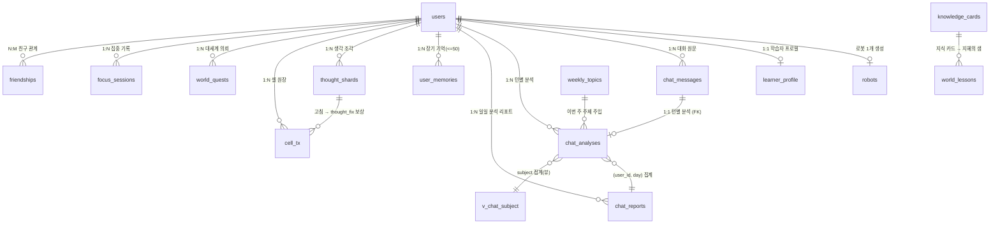

# RooMi 데이터베이스 설계서(전체 46 테이블)

> **Version 1.0 / 2026-11-09 · 대응 코드 `server.js` v1.40**
> 용도: 데이터베이스 교과 기말발표 / 발표 심사 / 코드 인수인계
> 증거 출처: **실행 중인 SQLite `sqlite_master` 원문**(`GET /api/chat/analysis/schema` 로 온라인에서 같은 DDL 회수 가능)
> 규모: **46 테이블 · 1 뷰 · 26 명시적 인덱스 · 112 API**
> 연관 문서: `docs/기술문서.md` §14、`docs/AI전용기억-데이터베이스설계-기말발표.md`(단일 표 심화)、`docs/11-ER-최종.svg`(구 32표 ER 도, 본 문서가 대체)

---

## 0. 한 문장

> **아이와 AI 가 주고받은 모든 문장은 먼저 원문 그대로 저장되고, 결정적 규칙이 매 턴 분석해 조회 가능한 학습 신호로 바꾼다; 제품 전체 46 테이블의 설계·제약·관계·보존 정책을 이 문서에 표별로 모두 적었다.**

이번 요구 분해(교수 피드백 «AI 와 나눈 대화를 저장하고 분석해야 하고, 모든 내용에 데이터베이스 설계가 있어야 한다»):

| # | 요구 | 전달 |
|---|---|---|
| R1 | AI 와의 대화 내용을 **저장** | `chat_messages` 에 user/assistant 전문 저장; v1.40 에서 흩어져 있던 4곳의 INSERT 를 유일한 입구 `saveChatTurn()` 으로 통합, 구조적으로 «저장했는데 빠짐» 을 차단 |
| R2 | 대화 내용을 **분석** | `chat_analyses`(턴별) + `chat_reports`(일별) + `v_chat_subject`(SQL 뷰) + 분석 API 4개 + 리포트 페이지 UI |
| R3 | **모든 내용에 데이터베이스 설계** | 본 문서: 46 테이블 표별 필드/제약, 8개 도메인 그룹, ER 도, 인덱스, 정규화, 프라이버시·보존 정책, 전체 DDL 부록 |

---

## 1. 설계 목표와 제약

| 차원 | 목표 | 구현 방식 |
|---|---|---|
| 무결성 | 모든 AI 대화가 원문으로 추적 가능 | `chat_analyses.user_msg_id → chat_messages.id`(FK), `UNIQUE(user_msg_id)` 로 1턴 1분석 보장 |
| 격리성 | 한 아이가 다른 아이의 데이터를 절대 읽을 수 없음 | 모든 API 가 `X-Token → users.id` 로 인증; 모든 SELECT/DELETE 에 `user_id` 조건 |
| 재현성 | 같은 대화는 항상 같은 분석 | **결정적 규칙 엔진**, 아이의 말을 다시 LLM 에 판정시키지 않음(비용 0·지연 0·단위 테스트 가능) |
| 멱등성 | 백필/재시도가 숫자를 부풀리지 않음 | `chat_reports` 는 «현재 분석 행으로 재집계 + UPSERT», `turns = turns + 1` 하지 않음 |
| 최소 수집 | 아동 제품은 적게 저장·적게 보관 | 원문 30일 자동 정리; `llm_logs` 에 본문 미저장; `isSafeText()` 가 전화/계정/링크 차단 |
| 설명 가능성 | 보호자/아이/심사자가 DB 구조를 볼 수 있음 | `/api/chat/analysis/schema` 가 `sqlite_master` 실제 DDL 반환, 리포트 페이지에서 펼칠 수 있음 |

---

## 2. 개념 모델(ER)



**도메인 그룹 개요**(8그룹, 46 테이블):

| 그룹 | 도메인 | 표 수 | 대표 표 |
|---|---|---|---|
| A | 사용자·신원 | 6 | `users` `robots` `learner_profile` |
| B | AI 대화 · 분석 · 기억 | 6 | `chat_messages` `chat_analyses` `chat_reports` `user_memories` |
| C | 학습 콘텐츠·계획 | 9 | `knowledge_cards` `learning_plans` `review_cards` |
| D | 경제 · 아이템 · 우편 | 6 | `cell_tx` `items` `inventory` |
| E | 대세계·게임 로그 | 9 | `village_props` `world_quests` `world_presence` |
| F | 친구·커뮤니티 | 6 | `friendships` `friend_messages` `guestbook` |
| G | 리텐션·상태 | 3 | `nudges` `mood_logs` `focus_sessions` |
| H | 자기 생각(v1.39) | 1 | `thought_shards` |

---

## 2.5 대화 분석 서브시스템(이번 신규, 핵심)

### 2.5.1 요구 → 개념 → 논리 → 물리

| 계층 | 내용 |
|---|---|
| 요구 | AI 와의 모든 대화 저장; «아이가 이번 주 무엇을 물었고, 어디서 막혔고, 기분이 어땠고, AI 가 힌트를 몇 번 줬는가» 에 답할 수 있어야 |
| 개념 | 엔티티: `대화 원문(turn)`、`턴별 분석(analysis)`、`일일 리포트(report)`; 관계: 1턴 → 1분석, N분석 → 1일보 |
| 논리 | `chat_messages(id, user_id, role, content, mode, hint_level, follow_up, ts)`; `chat_analyses(..., user_msg_id FK UNIQUE, ai_msg_id, subject, intent, senti
| 물리 | `idx_chat_user_ts(user_id, ts)` 이력 조회; `idx_ca_user_day(user_id, day)` 주간 리포트; `idx_ca_subject(user_id, subject)` 주제 분포; `v_chat_subject` 뷰로 집계 표 중복 저장 회피 |

### 2.5.2 데이터 흐름

```
POST /api/chat (4개 분기: 일반 / 잊어줘 / 누가만들었어 / LLM)
        │
        ▼  saveChatTurn()  ← 전 프로젝트에서 chat_messages 에 쓰는 유일한 곳
  ① INSERT user 메시지 ──► chat_messages.id
  ② INSERT assistant 메시지 ──► chat_messages.id
  ③ analyzeChatText() 결정적 규칙 → 16개 특징
  ④ INSERT OR IGNORE chat_analyses (user_msg_id, ai_msg_id, ...)
  ⑤ (user_id, day) 재집계 → UPSERT chat_reports
        │
        ▼  조회
  GET /api/chat/analysis           일보 + 주간 추이 + 주제(뷰) + intent 분포 + 커버리지
  GET /api/chat/analysis/messages  chat_analyses ⋈ chat_messages (원문 JOIN)
  GET /api/chat/analysis/schema    sqlite_master 실제 DDL
  POST /api/chat/analysis/rebuild  과거 대화 소급 분석 (멱등)
  POST /api/chat/reset             원문 + 분석 + 리포트 동시 삭제
```

### 2.5.3 분석 차원과 규칙(LLM 미호출)

| 필드 | 값 | 판정 |
|---|---|---|
| `subject` | 수학 / 코딩 / 과학 / 언어 / 로봇·마을 / 일상 | 순서 있는 키워드 정규식, 첫 매칭 |
| `intent` | 인사 / 힌트 요청 / 마음 표현 / 복습 / 질문 / 이야기 | 순서 있는 키워드 정규식 |
| `sentiment` | 밝음 / 보통 / 힘듦 | 부정어가 긍정어보다 우선(아이의 «힘들지만 재밌어» 는 힘듦으로 판정, 도움이 필요한 신호를 놓치지 않기 위해) |
| `stuck` | 0 / 1 | `모르겠 / 어렵 / 막혔 / 틀렸 / 헷갈 / 포기 / …` |
| `solved` | 0 / 1 | `/api/chat` 의 `solved` 판정 |
| `word_count` / `question_count` | 정수 | 아이 발화 길이, 질문 횟수 |
| `reply_has_hint` / `reply_has_praise` | 0 / 1 | **AI 응답**도 분석해 «루미가 힌트를 줬는가 / 칭찬했는가» 에 답함 |
| `keywords` | 쉼표 문자열(≤5) | 매칭 단어 중복 제거, «자주 막히는 지점» 에 사용 |

### 2.5.4 이렇게 설계한 이유(발표 가능한 선택)

1. **원문과 분석을 분리**: 규칙은 계속 바뀌고 원문은 바뀌면 안 된다. 분리하면 언제든 `rebuild` 가능하고 `chat_messages` 는 좁은 표로 유지되어 이력 조회가 빠르다.
2. **1턴 1행 + `UNIQUE(user_msg_id)`** : DB 차원에서 중복 분석을 막는 것이 애플리케이션 `if` 보다 신뢰할 수 있다.
3. **일보는 물화 집계, 주제 분포는 뷰**: 일보는 하루에 여러 번 읽히고 `summary` 텍스트를 생성해야 하므로 저장; 주제 분포는 단순 `GROUP BY` 이므로 뷰로 두어 중복·불일치를 피한다. 의도적인 «부분 반정규화».
4. **분석을 LLM 에 맡기지 않음**: 아동 제품의 «감정/막힘» 판단을 LLM 에 맡기면 재현성도 없고 콘텐츠 위험도 있다; 규칙 엔진은 단위 테스트로 한 줄씩 단정할 수 있다.
5. **reset 시 세 표 동시 삭제**: 그렇지 않으면 «원문은 삭제, 분석은 남음» 고아 행이 생긴다 — FK 제약이 막으려던 바로 그 상황.
6. **SQLite 캐스케이드 삭제 미사용**: `PRAGMA foreign_keys` 상태가 실행 환경마다 달라서, 삭제 순서를 애플리케이션 계층에서 명시적으로 보장(분석 → 리포트 → 원문), FK 는 설계 문서와 `sqlite_master` 의 무결성 선언으로만 사용 |

---

## 3. 무결성 제약과 인덱스 전략

| 유형 | 예 | 역할 |
|---|---|---|
| 기본 키 | 모든 표 `INTEGER PRIMARY KEY AUTOINCREMENT`(`world_presence` / `learner_profile` 은 업무 키) | 안정적인 행 식별자 |
| 외래 키 | `chat_analyses.user_msg_id → chat_messages.id` | 분석 결과가 반드시 원문으로 추적 가능해야 |
| 유일 | `chat_reports` 의 `(user_id, day)`、`user_msg_id`、`user_memories` / `village_props` / `world_s
| 인덱스 | `idx_chat_user_ts` / `idx_ca_user_day` / `idx_ca_subject` / `idx_mem_user` / `idx_review_due` …(총 26개) | 전부 «사용자별
| 기본값 | `ts = datetime('now','+9 hours')` | KST 통일 일계, 배포 환경 시간대와 무관 |
| 뷰 | `v_chat_subject` | 주제 분포 실시간 집계, 중복 저장 없음 |

---

## 4. 정규화와 반정규화

- **3NF 중심**: 사용자·상품·로그·관계가 각각 독립, 이행 종속 없음; `cell_tx` 가 셀의 유일한 사실 출처이고 잔액은 원장 합산.
- **의도적 반정규화**:
  - `users.cell_balance` 는 `cell_tx` 합산을 중복 보관 → 첫 화면 집계 쿼리 0회, `grantCell()` 이 같은 함수 안에서 이중 기록해 일관성 보장.
  - `chat_reports` 는 `chat_analyses` 집계를 중복 보관 → 일보 O(1) 읽기, «재집계 + UPSERT» 로 멱등 보장.
  - `users.understanding` 과 `learner_profile.understanding` 이중 기록 → 과거 코드 경로 호환, `profileFor()` 는 learner_profile 기준.
- **소프트 삭제 vs 하드 삭제**: 아동 제품은 «최소 보관» 원칙, 채팅은 30일 하드 삭제; `forgetMemories()` 는 건별 삭제 지원, «잊혀질 권리» 시연 요구에 부합.

---

## 5. 프라이버시·격리·운영

| 항목 | 정책 |
|---|---|
| 인증 | `X-Token → users.token`, 서버는 클라이언트가 보낸 `user_id` 를 신뢰하지 않음 |
| 행 격리 | 모든 조회에 `user_id`; 친구 좌표(`world_presence`)는 서버가 `friendships.status='accepted'` 확인 후에만 내려줌 |
| 입력 필터 | `isSafeText()` 가 6자리 이상 숫자·전화/계정/링크·성인/폭력 단어 차단, 길이 ≤200 |
| 콘텐츠 최소화 | `llm_logs` 는 model/latency/ok 만, 대화 본문 미저장 |
| 보존 | 대화 원문과 해당 분석 30일; 기동 시 `chat_messages` 정리, `reset` 시 세 표 동시 정리 |
| 백업 | 배포는 `DB_PATH=/tmp/dorobot-online.db`(샌드박스 영구 디렉터리); 로컬 개발 `roomi.db`; 마이그레이션은 `CREATE TABLE IF NOT EXISTS` + `try { ALTER TABL

---

## 6. 기말발표 «문제 → 설계 → 구현 → 증거»

| 문제 | 설계 | 구현 | 증거 |
|---|---|---|---|
| 채팅이 숫자로만 세어지고 이해되지 않음 | 원문 / 턴별 분석 / 일보 3층 | `chat_messages` + `chat_analyses` + `chat_reports` + `v_chat_subject` | 본 문서 §2.5、`/api
| «저장은 했는데 분석이 빠짐» 우려 | 단일 쓰기 입구 + DB 유일 제약 | `saveChatTurn()`(전 프로젝트 `INSERT INTO chat_messages` 1곳), `UNIQUE(user_msg_id)` | `coverag
| 분석 결과 재현 불가 | 결정적 규칙, LLM 판정 미사용 | `analyzeChatText()` 16 특징 | 분수→수학/막힘, 코딩→코딩/막힘 단위 테스트 PASS |
| 리포트를 아이·보호자에게 보여야 | 리포트 패널 + 턴별 상세 + DDL 펼치기 | `#ca-panel` / `#chat-analysis-modal` / `#ca-ddl` | 리포트 스크린샷 |
| «모든 내용에 DB 설계» | 46 표 필드별 + ER + 전체 DDL | 본 문서(`sqlite_master` 자동 생성) | §7 표별 정의 + 부록 A |

---

## 7. 논리 설계 — 46 표별 정의

> 아래 표는 **실행 중인 SQLite `sqlite_master` 에서 자동 생성**, 필드와 제약이 온라인 코드와 1:1 대응;
> «용도» 는 사람이 표기. PK / FK / UNIQUE / DEFAULT 는 실제 DDL 기준.

### A. 사용자·신원

#### `users` — 계정 주표: token, 레벨, 경험치, 연속 방문, 셀 잔액, 이해도

| 컬럼 | 타입 / 제약 |
|---|---|
| `id` | `INTEGER PRIMARY KEY AUTOINCREMENT` |
| `nickname` | `TEXT UNIQUE NOT NULL` |
| `cell_balance` | `INTEGER NOT NULL DEFAULT 0` |
| `created_at` | `TEXT DEFAULT (datetime('now','+9 hours'))` |
| `friend_code` | `TEXT` |
| `token` | `TEXT` |
| `level` | `INTEGER NOT NULL DEFAULT 1` |
| `exp` | `INTEGER NOT NULL DEFAULT 0` |
| `streak` | `INTEGER NOT NULL DEFAULT 0` |
| `last_visit` | `TEXT` |
| `revive_streak` | `INTEGER` |
| `revive_until` | `TEXT` |
| `parent_ok` | `INTEGER NOT NULL DEFAULT 0` |
| `play_minutes` | `INTEGER NOT NULL DEFAULT 0` |
| `play_bonus` | `INTEGER NOT NULL DEFAULT 0` |
| `play_day` | `TEXT` |
| `understanding` | `INTEGER NOT NULL DEFAULT 0` |

#### `robots` — 아이가 만든 로봇(템플릿 / 색 / 성격 / 인사말)

| 컬럼 | 타입 / 제약 |
|---|---|
| `id` | `INTEGER PRIMARY KEY AUTOINCREMENT` |
| `user_id` | `INTEGER NOT NULL REFERENCES users(id)` |
| `name` | `TEXT NOT NULL` |
| `template` | `TEXT NOT NULL` |
| `palette` | `TEXT NOT NULL` |
| `personality` | `TEXT NOT NULL` |
| `greeting` | `TEXT NOT NULL` |
| `created_at` | `TEXT DEFAULT (datetime('now','+9 hours'))` |

#### `robot_lines` — 로봇 대사 풀, 성격별 사용

| 컬럼 | 타입 / 제약 |
|---|---|
| `id` | `INTEGER PRIMARY KEY AUTOINCREMENT` |
| `personality` | `TEXT NOT NULL` |
| `situation` | `TEXT NOT NULL` |
| `line` | `TEXT NOT NULL` |

#### `learner_profile` — 학습자 장기 프로필: 이해도, 약점 주제, 학습 선호

| 컬럼 | 타입 / 제약 |
|---|---|
| `user_id` | `INTEGER PRIMARY KEY` |
| `understanding` | `INTEGER NOT NULL DEFAULT 0` |
| `weak_topics` | `TEXT` |
| `hint_style` | `TEXT` |
| `last_summary` | `TEXT` |
| `updated_at` | `TEXT DEFAULT (datetime('now','+9 hours'))` |
| `pref_minutes` | `INTEGER NOT NULL DEFAULT 10` |
| `pref_time` | `TEXT NOT NULL DEFAULT 'afternoon'` |
| `pref_subjects` | `TEXT NOT NULL DEFAULT ''` |
| `pref_difficulty` | `TEXT NOT NULL DEFAULT 'normal'` |
| `friend_chat_enabled` | `INTEGER NOT NULL DEFAULT 1` |

#### `visits` — 일별 방문 기록, streak 과 재접속률에 사용

| 컬럼 | 타입 / 제약 |
|---|---|
| `id` | `INTEGER PRIMARY KEY AUTOINCREMENT` |
| `user_id` | `INTEGER NOT NULL` |
| `entered_at` | `TEXT DEFAULT (datetime('now','+9 hours'))` |
| `duration` | `INTEGER DEFAULT 0` |
| `last_beat` | `INTEGER` |

#### `class_logs` — 수업 출석 / 교실 연동 기록

| 컬럼 | 타입 / 제약 |
|---|---|
| `id` | `INTEGER PRIMARY KEY AUTOINCREMENT` |
| `user_id` | `INTEGER NOT NULL` |
| `week_start` | `TEXT NOT NULL` |
| `reward` | `INTEGER NOT NULL DEFAULT 0` |
| `ts` | `TEXT DEFAULT (datetime('now','+9 hours'))` |

### B. AI 대화 · 분석 · 기억

#### `chat_messages` — ★ 대화 원문(user + assistant 전량 저장, 30일 보존)

| 컬럼 | 타입 / 제약 |
|---|---|
| `id` | `INTEGER PRIMARY KEY AUTOINCREMENT` |
| `user_id` | `INTEGER NOT NULL` |
| `role` | `TEXT NOT NULL` |
| `content` | `TEXT NOT NULL` |
| `mode` | `TEXT NOT NULL DEFAULT 'chat'` |
| `hint_level` | `INTEGER` |
| `ts` | `TEXT DEFAULT (datetime('now','+9 hours'))` |
| `follow_up` | `TEXT` |

#### `chat_analyses` — ★ v1.40 턴별 분석 결과, 1 turn = 1 row, FK → chat_messages

| 컬럼 | 타입 / 제약 |
|---|---|
| `id` | `INTEGER PRIMARY KEY AUTOINCREMENT` |
| `user_id` | `INTEGER NOT NULL` |
| `user_msg_id` | `INTEGER NOT NULL` |
| `ai_msg_id` | `INTEGER` |
| `day` | `TEXT NOT NULL` |
| `mode` | `TEXT NOT NULL DEFAULT 'chat'` |
| `topic` | `TEXT` |
| `subject` | `TEXT` |
| `intent` | `TEXT` |
| `sentiment` | `TEXT` |
| `stuck` | `INTEGER NOT NULL DEFAULT 0` |
| `hint_level` | `INTEGER` |
| `solved` | `INTEGER NOT NULL DEFAULT 0` |
| `word_count` | `INTEGER NOT NULL DEFAULT 0` |
| `question_count` | `INTEGER NOT NULL DEFAULT 0` |
| `reply_len` | `INTEGER NOT NULL DEFAULT 0` |
| `reply_has_hint` | `INTEGER NOT NULL DEFAULT 0` |
| `reply_has_praise` | `INTEGER NOT NULL DEFAULT 0` |
| `keywords` | `TEXT` |
| `created_at` | `TEXT DEFAULT (datetime('now','+9 hours'))` |

- 표 수준 제약: `UNIQUE(user_msg_id)`
- 표 수준 제약: `FOREIGN KEY(user_msg_id) REFERENCES chat_messages(id)`

#### `chat_reports` — ★ v1.40 사용자+일 집계 분석 리포트(UPSERT, 멱등)

| 컬럼 | 타입 / 제약 |
|---|---|
| `id` | `INTEGER PRIMARY KEY AUTOINCREMENT` |
| `user_id` | `INTEGER NOT NULL` |
| `day` | `TEXT NOT NULL` |
| `turns` | `INTEGER NOT NULL DEFAULT 0` |
| `user_words` | `INTEGER NOT NULL DEFAULT 0` |
| `stuck_count` | `INTEGER NOT NULL DEFAULT 0` |
| `solved_count` | `INTEGER NOT NULL DEFAULT 0` |
| `hint_sum` | `INTEGER NOT NULL DEFAULT 0` |
| `top_subject` | `TEXT` |
| `top_intent` | `TEXT` |
| `mood` | `TEXT` |
| `summary` | `TEXT` |
| `updated_at` | `TEXT DEFAULT (datetime('now','+9 hours'))` |

- 표 수준 제약: `UNIQUE(user_id, day)`

#### `llm_logs` — LLM 호출 로그: model / latency / 성공 여부(원문 미포함)

| 컬럼 | 타입 / 제약 |
|---|---|
| `id` | `INTEGER PRIMARY KEY AUTOINCREMENT` |
| `user_id` | `INTEGER` |
| `mode` | `TEXT` |
| `model` | `TEXT` |
| `latency_ms` | `INTEGER` |
| `ok` | `INTEGER DEFAULT 0` |
| `ts` | `TEXT DEFAULT (datetime('now','+9 hours'))` |

#### `user_memories` — AI 전용 장기 기억: 사실/선호/학습 상태, UPSERT + top6 회수

| 컬럼 | 타입 / 제약 |
|---|---|
| `id` | `INTEGER PRIMARY KEY AUTOINCREMENT` |
| `user_id` | `INTEGER NOT NULL` |
| `kind` | `TEXT NOT NULL` |
| `key` | `TEXT NOT NULL` |
| `value` | `TEXT NOT NULL` |
| `confidence` | `REAL NOT NULL DEFAULT 0.7` |
| `source` | `TEXT DEFAULT 'chat'` |
| `created_at` | `TEXT DEFAULT (datetime('now','+9 hours'))` |
| `updated_at` | `TEXT DEFAULT (datetime('now','+9 hours'))` |
| `last_used_at` | `TEXT` |
| `expires_at` | `TEXT` |

- 표 수준 제약: `UNIQUE(user_id, kind, key)`

#### `weekly_topics` — 운영자가 지정한 주간 챕터 주제(자동 순환 덮어쓰기)

| 컬럼 | 타입 / 제약 |
|---|---|
| `id` | `INTEGER PRIMARY KEY AUTOINCREMENT` |
| `week_start` | `TEXT NOT NULL` |
| `chapter` | `INTEGER NOT NULL DEFAULT 1` |
| `topic` | `TEXT NOT NULL` |
| `keywords` | `TEXT` |
| `created_at` | `TEXT DEFAULT (datetime('now','+9 hours'))` |

### C. 학습 콘텐츠·계획

#### `knowledge_cards` — 지식 카드: 개념, 비유, 예시, 3단계 힌트, 퀴즈

| 컬럼 | 타입 / 제약 |
|---|---|
| `id` | `INTEGER PRIMARY KEY AUTOINCREMENT` |
| `topic` | `TEXT NOT NULL` |
| `chapter` | `INTEGER DEFAULT 1` |
| `concept` | `TEXT NOT NULL` |
| `analogy` | `TEXT` |
| `example` | `TEXT` |
| `hint_l1` | `TEXT` |
| `hint_l2` | `TEXT` |
| `hint_l3` | `TEXT` |
| `quiz` | `TEXT` |
| `tags` | `TEXT` |

#### `learning_help_logs` — AI 학습 도움 기록(해결 여부 / 난이도)

| 컬럼 | 타입 / 제약 |
|---|---|
| `id` | `INTEGER PRIMARY KEY AUTOINCREMENT` |
| `user_id` | `INTEGER NOT NULL` |
| `day` | `TEXT NOT NULL` |
| `subject` | `TEXT` |
| `level` | `INTEGER DEFAULT 1` |
| `solved` | `INTEGER DEFAULT 0` |
| `ts` | `TEXT DEFAULT (datetime('now','+9 hours'))` |

#### `learning_plans` — AI 가 생성한 오늘 학습 계획과 단계

| 컬럼 | 타입 / 제약 |
|---|---|
| `id` | `INTEGER PRIMARY KEY AUTOINCREMENT` |
| `user_id` | `INTEGER NOT NULL` |
| `day` | `TEXT NOT NULL` |
| `plan_json` | `TEXT NOT NULL` |
| `source` | `TEXT DEFAULT 'ai'` |
| `created_at` | `TEXT DEFAULT (datetime('now','+9 hours'))` |

- 표 수준 제약: `UNIQUE(user_id, day)`

#### `weekly_goals` — 이번 주 목표와 진행

| 컬럼 | 타입 / 제약 |
|---|---|
| `id` | `INTEGER PRIMARY KEY AUTOINCREMENT` |
| `user_id` | `INTEGER NOT NULL` |
| `week_start` | `TEXT NOT NULL` |
| `goals_json` | `TEXT NOT NULL` |
| `source` | `TEXT DEFAULT 'ai'` |
| `created_at` | `TEXT DEFAULT (datetime('now','+9 hours'))` |

- 표 수준 제약: `UNIQUE(user_id, week_start)`

#### `goal_claims` — 목표 보상 수령 기록(중복 방지)

| 컬럼 | 타입 / 제약 |
|---|---|
| `id` | `INTEGER PRIMARY KEY AUTOINCREMENT` |
| `user_id` | `INTEGER NOT NULL` |
| `week_start` | `TEXT NOT NULL` |
| `reward` | `INTEGER NOT NULL DEFAULT 30` |
| `created_at` | `TEXT DEFAULT (datetime('now','+9 hours'))` |

- 표 수준 제약: `UNIQUE(user_id, week_start)`

#### `review_cards` — 간격 복습 카드(오답 기반 생성, due_date)

| 컬럼 | 타입 / 제약 |
|---|---|
| `id` | `INTEGER PRIMARY KEY AUTOINCREMENT` |
| `user_id` | `INTEGER NOT NULL` |
| `card_id` | `INTEGER NOT NULL` |
| `topic` | `TEXT` |
| `question` | `TEXT NOT NULL` |
| `options_json` | `TEXT NOT NULL` |
| `answer` | `INTEGER NOT NULL` |
| `wrong_count` | `INTEGER NOT NULL DEFAULT 1` |
| `due_date` | `TEXT NOT NULL` |
| `done` | `INTEGER NOT NULL DEFAULT 0` |
| `created_at` | `TEXT DEFAULT (datetime('now','+9 hours'))` |

- 표 수준 제약: `UNIQUE(user_id, card_id, due_date)`

#### `daily_quests` — 일일 과제 풀(AI 미션 포함, 주제별 생성)

| 컬럼 | 타입 / 제약 |
|---|---|
| `id` | `INTEGER PRIMARY KEY AUTOINCREMENT` |
| `quest_date` | `TEXT NOT NULL` |
| `type` | `TEXT NOT NULL` |
| `title` | `TEXT NOT NULL` |
| `reward` | `INTEGER NOT NULL` |
| `topic` | `TEXT` |

#### `quest_logs` — 과제 완료 기록(user+quest+day 판정)

| 컬럼 | 타입 / 제약 |
|---|---|
| `id` | `INTEGER PRIMARY KEY AUTOINCREMENT` |
| `user_id` | `INTEGER NOT NULL` |
| `quest_id` | `INTEGER NOT NULL` |
| `ts` | `TEXT DEFAULT (datetime('now','+9 hours'))` |
| `reward` | `INTEGER NOT NULL` |

#### `world_lessons` — 대세계 지혜의 샘 3곳의 일일 퀴즈 기록

| 컬럼 | 타입 / 제약 |
|---|---|
| `id` | `INTEGER PRIMARY KEY AUTOINCREMENT` |
| `user_id` | `INTEGER NOT NULL` |
| `day` | `TEXT NOT NULL` |
| `station` | `INTEGER NOT NULL` |
| `card_id` | `INTEGER NOT NULL` |
| `solved` | `INTEGER NOT NULL DEFAULT 0` |
| `wrong` | `INTEGER NOT NULL DEFAULT 0` |
| `created_at` | `TEXT DEFAULT (datetime('now','+9 hours'))` |

- 표 수준 제약: `UNIQUE(user_id, day, station)`

### D. 경제 · 아이템 · 우편

#### `cell_tx` — 셀 수지 원장(모든 보상/소비의 유일한 사실 출처)

| 컬럼 | 타입 / 제약 |
|---|---|
| `id` | `INTEGER PRIMARY KEY AUTOINCREMENT` |
| `user_id` | `INTEGER NOT NULL` |
| `amount` | `INTEGER NOT NULL` |
| `source` | `TEXT NOT NULL` |
| `ts` | `TEXT DEFAULT (datetime('now','+9 hours'))` |

#### `items` — 상품 정의(부품 / 장식 / 스킨 / 조각)

| 컬럼 | 타입 / 제약 |
|---|---|
| `id` | `INTEGER PRIMARY KEY AUTOINCREMENT` |
| `name` | `TEXT NOT NULL` |
| `type` | `TEXT NOT NULL` |
| `price` | `INTEGER NOT NULL` |
| `consumable` | `INTEGER NOT NULL DEFAULT 0` |
| `limited_days` | `TEXT` |

#### `inventory` — 사용자 소유물

| 컬럼 | 타입 / 제약 |
|---|---|
| `id` | `INTEGER PRIMARY KEY AUTOINCREMENT` |
| `user_id` | `INTEGER NOT NULL` |
| `item_id` | `INTEGER NOT NULL` |
| `qty` | `INTEGER NOT NULL DEFAULT 1` |

#### `mailbox` — 우편과 보상 수령 상태(미읽음 배지 포함)

| 컬럼 | 타입 / 제약 |
|---|---|
| `id` | `INTEGER PRIMARY KEY AUTOINCREMENT` |
| `user_id` | `INTEGER NOT NULL` |
| `title` | `TEXT NOT NULL` |
| `body` | `TEXT` |
| `cell` | `INTEGER NOT NULL DEFAULT 0` |
| `item_id` | `INTEGER` |
| `tag` | `TEXT` |
| `claimed` | `INTEGER NOT NULL DEFAULT 0` |
| `ts` | `TEXT DEFAULT (datetime('now','+9 hours'))` |

#### `seasons` — 시즌 구간과 종료 보상

| 컬럼 | 타입 / 제약 |
|---|---|
| `id` | `INTEGER PRIMARY KEY AUTOINCREMENT` |
| `name` | `TEXT NOT NULL` |
| `start_week` | `TEXT NOT NULL` |
| `end_week` | `TEXT NOT NULL` |
| `reward_cell` | `INTEGER DEFAULT 0` |

#### `season_claims` — 시즌 보상 수령(주 1회 유일)

| 컬럼 | 타입 / 제약 |
|---|---|
| `id` | `INTEGER PRIMARY KEY AUTOINCREMENT` |
| `user_id` | `INTEGER NOT NULL` |
| `week` | `TEXT NOT NULL` |
| `reward` | `INTEGER NOT NULL DEFAULT 0` |
| `claimed_at` | `TEXT DEFAULT (datetime('now','+9 hours'))` |

- 표 수준 제약: `UNIQUE(user_id, week)`

### E. 대세계·게임 로그

#### `village_props` — 대세계 영구 성장물(`relic_*` 등, 날짜 넘김 유지)

| 컬럼 | 타입 / 제약 |
|---|---|
| `id` | `INTEGER PRIMARY KEY AUTOINCREMENT` |
| `user_id` | `INTEGER NOT NULL` |
| `prop_key` | `TEXT NOT NULL` |
| `granted_at` | `TEXT DEFAULT (datetime('now','+9 hours'))` |

- 표 수준 제약: `UNIQUE(user_id, prop_key)`

#### `treasure_claims` — 일일 보물상자 수령(user+day+spot 유일)

| 컬럼 | 타입 / 제약 |
|---|---|
| `id` | `INTEGER PRIMARY KEY AUTOINCREMENT` |
| `user_id` | `INTEGER NOT NULL` |
| `day` | `TEXT NOT NULL` |
| `spot` | `INTEGER NOT NULL` |
| `claimed_at` | `TEXT DEFAULT (datetime('now','+9 hours'))` |

- 표 수준 제약: `UNIQUE(user_id, day, spot)`

#### `world_quests` — 대세계 일일 의뢰(`__skip__` 행=건너뛰기 권)

| 컬럼 | 타입 / 제약 |
|---|---|
| `id` | `INTEGER PRIMARY KEY AUTOINCREMENT` |
| `user_id` | `INTEGER NOT NULL` |
| `day` | `TEXT NOT NULL` |
| `quest` | `TEXT NOT NULL` |
| `done` | `INTEGER NOT NULL DEFAULT 0` |
| `reward` | `INTEGER NOT NULL DEFAULT 0` |
| `ts` | `TEXT DEFAULT (datetime('now','+9 hours'))` |

#### `world_stars` — 의뢰로 얻는 빛 조각 3개

| 컬럼 | 타입 / 제약 |
|---|---|
| `id` | `INTEGER PRIMARY KEY AUTOINCREMENT` |
| `user_id` | `INTEGER NOT NULL` |
| `day` | `TEXT NOT NULL` |
| `star` | `INTEGER NOT NULL` |
| `ts` | `TEXT DEFAULT (datetime('now','+9 hours'))` |

#### `world_secrets` — 이스터에그 최초 열람（계정당 1회 보상）

| 컬럼 | 타입 / 제약 |
|---|---|
| `id` | `INTEGER PRIMARY KEY AUTOINCREMENT` |
| `user_id` | `INTEGER NOT NULL` |
| `key` | `TEXT NOT NULL` |
| `ts` | `TEXT DEFAULT (datetime('now','+9 hours'))` |

#### `world_presence` — 친구 동시 접속: 1.6s 폴링 + 45s TTL 실시간 좌표

| 컬럼 | 타입 / 제약 |
|---|---|
| `user_id` | `INTEGER PRIMARY KEY` |
| `x` | `REAL NOT NULL DEFAULT 0` |
| `z` | `REAL NOT NULL DEFAULT 0` |
| `ry` | `REAL NOT NULL DEFAULT 0` |
| `anim` | `TEXT DEFAULT 'Idle'` |
| `ts` | `INTEGER NOT NULL` |

#### `game_logs` — 미니게임 성적과 보상 기록

| 컬럼 | 타입 / 제약 |
|---|---|
| `id` | `INTEGER PRIMARY KEY AUTOINCREMENT` |
| `user_id` | `INTEGER NOT NULL` |
| `day` | `TEXT NOT NULL` |
| `kind` | `TEXT NOT NULL` |
| `score` | `INTEGER NOT NULL DEFAULT 0` |
| `reward` | `INTEGER NOT NULL DEFAULT 0` |
| `ts` | `TEXT DEFAULT (datetime('now','+9 hours'))` |

#### `interact_logs` — 마이룸 상호작용(먹이/놀기 등) 기록

| 컬럼 | 타입 / 제약 |
|---|---|
| `id` | `INTEGER PRIMARY KEY AUTOINCREMENT` |
| `user_id` | `INTEGER NOT NULL` |
| `day` | `TEXT NOT NULL` |
| `situation` | `TEXT NOT NULL` |
| `ts` | `TEXT DEFAULT (datetime('now','+9 hours'))` |

#### `workshop_logs` — 공작소 색칠/성격 변경 기록

| 컬럼 | 타입 / 제약 |
|---|---|
| `id` | `INTEGER PRIMARY KEY AUTOINCREMENT` |
| `user_id` | `INTEGER NOT NULL` |
| `day` | `TEXT NOT NULL` |
| `kind` | `TEXT NOT NULL` |
| `ts` | `TEXT DEFAULT (datetime('now','+9 hours'))` |

### F. 친구·커뮤니티

#### `friendships` — 친구 관계(pending / accepted)

| 컬럼 | 타입 / 제약 |
|---|---|
| `id` | `INTEGER PRIMARY KEY AUTOINCREMENT` |
| `user_a` | `INTEGER NOT NULL` |
| `user_b` | `INTEGER NOT NULL` |
| `status` | `TEXT NOT NULL DEFAULT 'pending'` |
| `created_at` | `TEXT DEFAULT (datetime('now','+9 hours'))` |

- 표 수준 제약: `UNIQUE(user_a, user_b)`

#### `cheers` — 일일 응원(하루 1회 중복 방지)

| 컬럼 | 타입 / 제약 |
|---|---|
| `id` | `INTEGER PRIMARY KEY AUTOINCREMENT` |
| `from_user` | `INTEGER NOT NULL` |
| `to_user` | `INTEGER NOT NULL` |
| `day` | `TEXT NOT NULL` |
| `created_at` | `TEXT DEFAULT (datetime('now','+9 hours'))` |

- 표 수준 제약: `UNIQUE(from_user, to_user, day)`

#### `friend_messages` — 친구 쪽지(하루 30통 제한 + 개인정보 필터)

| 컬럼 | 타입 / 제약 |
|---|---|
| `id` | `INTEGER PRIMARY KEY AUTOINCREMENT` |
| `from_user` | `INTEGER NOT NULL` |
| `to_user` | `INTEGER NOT NULL` |
| `body` | `TEXT NOT NULL` |
| `created_at` | `TEXT DEFAULT (datetime('now','+9 hours'))` |
| `read_at` | `TEXT` |

#### `friend_blocks` — 차단 목록

| 컬럼 | 타입 / 제약 |
|---|---|
| `id` | `INTEGER PRIMARY KEY AUTOINCREMENT` |
| `user_id` | `INTEGER NOT NULL` |
| `blocked_id` | `INTEGER NOT NULL` |
| `created_at` | `TEXT DEFAULT (datetime('now','+9 hours'))` |

- 표 수준 제약: `UNIQUE(user_id, blocked_id)`

#### `friend_reports` — 신고 기록

| 컬럼 | 타입 / 제약 |
|---|---|
| `id` | `INTEGER PRIMARY KEY AUTOINCREMENT` |
| `reporter_id` | `INTEGER NOT NULL` |
| `target_id` | `INTEGER NOT NULL` |
| `reason` | `TEXT` |
| `created_at` | `TEXT DEFAULT (datetime('now','+9 hours'))` |

#### `guestbook` — 친구 마을 방명록

| 컬럼 | 타입 / 제약 |
|---|---|
| `id` | `INTEGER PRIMARY KEY AUTOINCREMENT` |
| `to_user` | `INTEGER NOT NULL` |
| `from_user` | `INTEGER NOT NULL` |
| `message` | `TEXT NOT NULL` |
| `created_at` | `TEXT DEFAULT (datetime('now','+9 hours'))` |

### G. 리텐션·상태

#### `nudges` — 루미가 먼저 말 거는 능동 넛지（하루 캐시）

| 컬럼 | 타입 / 제약 |
|---|---|
| `id` | `INTEGER PRIMARY KEY AUTOINCREMENT` |
| `user_id` | `INTEGER NOT NULL` |
| `day` | `TEXT NOT NULL` |
| `kind` | `TEXT NOT NULL` |
| `text` | `TEXT NOT NULL` |
| `cta` | `TEXT` |
| `target` | `TEXT` |
| `shown` | `INTEGER NOT NULL DEFAULT 0` |
| `clicked` | `INTEGER NOT NULL DEFAULT 0` |
| `created_at` | `TEXT DEFAULT (datetime('now','+9 hours'))` |

- 표 수준 제약: `UNIQUE(user_id, day)`

#### `mood_logs` — 오늘 기분 → 대화 말투 / 방 조명 연동

| 컬럼 | 타입 / 제약 |
|---|---|
| `id` | `INTEGER PRIMARY KEY AUTOINCREMENT` |
| `user_id` | `INTEGER NOT NULL` |
| `day` | `TEXT NOT NULL` |
| `mood` | `TEXT NOT NULL` |
| `created_at` | `TEXT DEFAULT (datetime('now','+9 hours'))` |

- 표 수준 제약: `UNIQUE(user_id, day)`

#### `focus_sessions` — 같이 집중 타이머（서버 실경과 시간 검증）

| 컬럼 | 타입 / 제약 |
|---|---|
| `id` | `INTEGER PRIMARY KEY AUTOINCREMENT` |
| `user_id` | `INTEGER NOT NULL` |
| `day` | `TEXT NOT NULL` |
| `minutes` | `INTEGER NOT NULL DEFAULT 0` |
| `started_at` | `TEXT` |
| `finished_at` | `TEXT` |
| `reward` | `INTEGER NOT NULL DEFAULT 0` |
| `done` | `INTEGER NOT NULL DEFAULT 0` |

### H. 자기 생각(v1.39)

#### `thought_shards` — ★ v1.39 생각 조각：처음 생각 → 고쳐 쓴 생각 → 별빛 셀

| 컬럼 | 타입 / 제약 |
|---|---|
| `id` | `INTEGER PRIMARY KEY AUTOINCREMENT` |
| `user_id` | `INTEGER NOT NULL` |
| `day` | `TEXT NOT NULL` |
| `chapter` | `INTEGER NOT NULL DEFAULT 1` |
| `topic` | `TEXT` |
| `stuck` | `TEXT NOT NULL` |
| `guess` | `TEXT NOT NULL` |
| `revised` | `TEXT` |
| `prompt_key` | `TEXT` |
| `status` | `TEXT NOT NULL DEFAULT 'open'` |
| `cell_reward` | `INTEGER NOT NULL DEFAULT 0` |
| `created_at` | `TEXT DEFAULT (datetime('now','+9 hours'))` |
| `fixed_at` | `TEXT` |


---

## 부록 A — 전체 DDL(`sqlite_master` 원문)

```sql
-- TABLE · cell_tx
CREATE TABLE cell_tx(
  id INTEGER PRIMARY KEY AUTOINCREMENT,
  user_id INTEGER NOT NULL,
  amount INTEGER NOT NULL,
  source TEXT NOT NULL,
  ts TEXT DEFAULT (datetime('now','+9 hours'))
);

-- TABLE · chat_analyses
CREATE TABLE chat_analyses(
  id INTEGER PRIMARY KEY AUTOINCREMENT,
  user_id INTEGER NOT NULL,
  user_msg_id INTEGER NOT NULL,
  ai_msg_id INTEGER,
  day TEXT NOT NULL,
  mode TEXT NOT NULL DEFAULT 'chat',
  topic TEXT,
  subject TEXT,
  intent TEXT,
  sentiment TEXT,
  stuck INTEGER NOT NULL DEFAULT 0,
  hint_level INTEGER,
  solved INTEGER NOT NULL DEFAULT 0,
  word_count INTEGER NOT NULL DEFAULT 0,
  question_count INTEGER NOT NULL DEFAULT 0,
  reply_len INTEGER NOT NULL DEFAULT 0,
  reply_has_hint INTEGER NOT NULL DEFAULT 0,
  reply_has_praise INTEGER NOT NULL DEFAULT 0,
  keywords TEXT,
  created_at TEXT DEFAULT (datetime('now','+9 hours')),
  UNIQUE(user_msg_id),
  FOREIGN KEY(user_msg_id) REFERENCES chat_messages(id)
);

-- TABLE · chat_messages
CREATE TABLE chat_messages(
  id INTEGER PRIMARY KEY AUTOINCREMENT,
  user_id INTEGER NOT NULL,
  role TEXT NOT NULL,
  content TEXT NOT NULL,
  mode TEXT NOT NULL DEFAULT 'chat',
  hint_level INTEGER,
  ts TEXT DEFAULT (datetime('now','+9 hours'))
, follow_up TEXT);

-- TABLE · chat_reports
CREATE TABLE chat_reports(
  id INTEGER PRIMARY KEY AUTOINCREMENT,
  user_id INTEGER NOT NULL,
  day TEXT NOT NULL,
  turns INTEGER NOT NULL DEFAULT 0,
  user_words INTEGER NOT NULL DEFAULT 0,
  stuck_count INTEGER NOT NULL DEFAULT 0,
  solved_count INTEGER NOT NULL DEFAULT 0,
  hint_sum INTEGER NOT NULL DEFAULT 0,
  top_subject TEXT,
  top_intent TEXT,
  mood TEXT,
  summary TEXT,
  updated_at TEXT DEFAULT (datetime('now','+9 hours')),
  UNIQUE(user_id, day)
);

-- TABLE · cheers
CREATE TABLE cheers(
  id INTEGER PRIMARY KEY AUTOINCREMENT,
  from_user INTEGER NOT NULL,
  to_user INTEGER NOT NULL,
  day TEXT NOT NULL,
  created_at TEXT DEFAULT (datetime('now','+9 hours')),
  UNIQUE(from_user, to_user, day)
);

-- TABLE · class_logs
CREATE TABLE class_logs(
  id INTEGER PRIMARY KEY AUTOINCREMENT,
  user_id INTEGER NOT NULL,
  week_start TEXT NOT NULL,
  reward INTEGER NOT NULL DEFAULT 0,
  ts TEXT DEFAULT (datetime('now','+9 hours'))
);

-- TABLE · daily_quests
CREATE TABLE daily_quests(
  id INTEGER PRIMARY KEY AUTOINCREMENT,
  quest_date TEXT NOT NULL,
  type TEXT NOT NULL,
  title TEXT NOT NULL,
  reward INTEGER NOT NULL
, topic TEXT);

-- TABLE · focus_sessions
CREATE TABLE focus_sessions(
  id INTEGER PRIMARY KEY AUTOINCREMENT,
  user_id INTEGER NOT NULL,
  day TEXT NOT NULL,
  minutes INTEGER NOT NULL DEFAULT 0,
  started_at TEXT,
  finished_at TEXT,
  reward INTEGER NOT NULL DEFAULT 0,
  done INTEGER NOT NULL DEFAULT 0
);

-- TABLE · friend_blocks
CREATE TABLE friend_blocks(
  id INTEGER PRIMARY KEY AUTOINCREMENT,
  user_id INTEGER NOT NULL,
  blocked_id INTEGER NOT NULL,
  created_at TEXT DEFAULT (datetime('now','+9 hours')),
  UNIQUE(user_id, blocked_id)
);

-- TABLE · friend_messages
CREATE TABLE friend_messages(
  id INTEGER PRIMARY KEY AUTOINCREMENT,
  from_user INTEGER NOT NULL,
  to_user INTEGER NOT NULL,
  body TEXT NOT NULL,
  created_at TEXT DEFAULT (datetime('now','+9 hours')),
  read_at TEXT
);

-- TABLE · friend_reports
CREATE TABLE friend_reports(
  id INTEGER PRIMARY KEY AUTOINCREMENT,
  reporter_id INTEGER NOT NULL,
  target_id INTEGER NOT NULL,
  reason TEXT,
  created_at TEXT DEFAULT (datetime('now','+9 hours'))
);

-- TABLE · friendships
CREATE TABLE friendships(
  id INTEGER PRIMARY KEY AUTOINCREMENT,
  user_a INTEGER NOT NULL,
  user_b INTEGER NOT NULL,
  status TEXT NOT NULL DEFAULT 'pending',
  created_at TEXT DEFAULT (datetime('now','+9 hours')),
  UNIQUE(user_a, user_b)
);

-- TABLE · game_logs
CREATE TABLE game_logs(
  id INTEGER PRIMARY KEY AUTOINCREMENT,
  user_id INTEGER NOT NULL,
  day TEXT NOT NULL,
  kind TEXT NOT NULL,
  score INTEGER NOT NULL DEFAULT 0,
  reward INTEGER NOT NULL DEFAULT 0,
  ts TEXT DEFAULT (datetime('now','+9 hours'))
);

-- TABLE · goal_claims
CREATE TABLE goal_claims(
  id INTEGER PRIMARY KEY AUTOINCREMENT,
  user_id INTEGER NOT NULL,
  week_start TEXT NOT NULL,
  reward INTEGER NOT NULL DEFAULT 30,
  created_at TEXT DEFAULT (datetime('now','+9 hours')),
  UNIQUE(user_id, week_start)
);

-- TABLE · guestbook
CREATE TABLE guestbook(
  id INTEGER PRIMARY KEY AUTOINCREMENT,
  to_user INTEGER NOT NULL,
  from_user INTEGER NOT NULL,
  message TEXT NOT NULL,
  created_at TEXT DEFAULT (datetime('now','+9 hours'))
);

-- TABLE · interact_logs
CREATE TABLE interact_logs(
  id INTEGER PRIMARY KEY AUTOINCREMENT,
  user_id INTEGER NOT NULL,
  day TEXT NOT NULL,
  situation TEXT NOT NULL,
  ts TEXT DEFAULT (datetime('now','+9 hours'))
);

-- TABLE · inventory
CREATE TABLE inventory(
  id INTEGER PRIMARY KEY AUTOINCREMENT,
  user_id INTEGER NOT NULL,
  item_id INTEGER NOT NULL,
  qty INTEGER NOT NULL DEFAULT 1
);

-- TABLE · items
CREATE TABLE items(
  id INTEGER PRIMARY KEY AUTOINCREMENT,
  name TEXT NOT NULL,
  type TEXT NOT NULL,
  price INTEGER NOT NULL
, consumable INTEGER NOT NULL DEFAULT 0, limited_days TEXT);

-- TABLE · knowledge_cards
CREATE TABLE knowledge_cards(
  id INTEGER PRIMARY KEY AUTOINCREMENT,
  topic TEXT NOT NULL,
  chapter INTEGER DEFAULT 1,
  concept TEXT NOT NULL,
  analogy TEXT,
  example TEXT,
  hint_l1 TEXT,
  hint_l2 TEXT,
  hint_l3 TEXT,
  quiz TEXT,
  tags TEXT
);

-- TABLE · learner_profile
CREATE TABLE learner_profile(
  user_id INTEGER PRIMARY KEY,
  understanding INTEGER NOT NULL DEFAULT 0,
  weak_topics TEXT,
  hint_style TEXT,
  last_summary TEXT,
  updated_at TEXT DEFAULT (datetime('now','+9 hours'))
, pref_minutes INTEGER NOT NULL DEFAULT 10, pref_time TEXT NOT NULL DEFAULT 'afternoon', pref_subjects TEXT NOT NULL DEFAULT '', pref_difficulty TEXT NOT NULL DEFAULT 'normal', friend_chat_enabled INTEGER NOT NULL DEFAULT 1);

-- TABLE · learning_help_logs
CREATE TABLE learning_help_logs(
  id INTEGER PRIMARY KEY AUTOINCREMENT,
  user_id INTEGER NOT NULL,
  day TEXT NOT NULL,
  subject TEXT,
  level INTEGER DEFAULT 1,
  solved INTEGER DEFAULT 0,
  ts TEXT DEFAULT (datetime('now','+9 hours'))
);

-- TABLE · learning_plans
CREATE TABLE learning_plans(
  id INTEGER PRIMARY KEY AUTOINCREMENT,
  user_id INTEGER NOT NULL,
  day TEXT NOT NULL,
  plan_json TEXT NOT NULL,
  source TEXT DEFAULT 'ai',
  created_at TEXT DEFAULT (datetime('now','+9 hours')),
  UNIQUE(user_id, day)
);

-- TABLE · llm_logs
CREATE TABLE llm_logs(
  id INTEGER PRIMARY KEY AUTOINCREMENT,
  user_id INTEGER,
  mode TEXT,
  model TEXT,
  latency_ms INTEGER,
  ok INTEGER DEFAULT 0,
  ts TEXT DEFAULT (datetime('now','+9 hours'))
);

-- TABLE · mailbox
CREATE TABLE mailbox(
  id INTEGER PRIMARY KEY AUTOINCREMENT,
  user_id INTEGER NOT NULL,
  title TEXT NOT NULL,
  body TEXT,
  cell INTEGER NOT NULL DEFAULT 0,
  item_id INTEGER,
  tag TEXT,
  claimed INTEGER NOT NULL DEFAULT 0,
  ts TEXT DEFAULT (datetime('now','+9 hours'))
);

-- TABLE · mood_logs
CREATE TABLE mood_logs(
  id INTEGER PRIMARY KEY AUTOINCREMENT,
  user_id INTEGER NOT NULL,
  day TEXT NOT NULL,
  mood TEXT NOT NULL,
  created_at TEXT DEFAULT (datetime('now','+9 hours')),
  UNIQUE(user_id, day)
);

-- TABLE · nudges
CREATE TABLE nudges(
  id INTEGER PRIMARY KEY AUTOINCREMENT,
  user_id INTEGER NOT NULL,
  day TEXT NOT NULL,
  kind TEXT NOT NULL,
  text TEXT NOT NULL,
  cta TEXT,
  target TEXT,
  shown INTEGER NOT NULL DEFAULT 0,
  clicked INTEGER NOT NULL DEFAULT 0,
  created_at TEXT DEFAULT (datetime('now','+9 hours')),
  UNIQUE(user_id, day)
);

-- TABLE · quest_logs
CREATE TABLE quest_logs(
  id INTEGER PRIMARY KEY AUTOINCREMENT,
  user_id INTEGER NOT NULL,
  quest_id INTEGER NOT NULL,
  ts TEXT DEFAULT (datetime('now','+9 hours')),
  reward INTEGER NOT NULL
);

-- TABLE · review_cards
CREATE TABLE review_cards(
  id INTEGER PRIMARY KEY AUTOINCREMENT,
  user_id INTEGER NOT NULL,
  card_id INTEGER NOT NULL,
  topic TEXT,
  question TEXT NOT NULL,
  options_json TEXT NOT NULL,
  answer INTEGER NOT NULL,
  wrong_count INTEGER NOT NULL DEFAULT 1,
  due_date TEXT NOT NULL,
  done INTEGER NOT NULL DEFAULT 0,
  created_at TEXT DEFAULT (datetime('now','+9 hours')),
  UNIQUE(user_id, card_id, due_date)
);

-- TABLE · robot_lines
CREATE TABLE robot_lines(
  id INTEGER PRIMARY KEY AUTOINCREMENT,
  personality TEXT NOT NULL,
  situation TEXT NOT NULL,
  line TEXT NOT NULL
);

-- TABLE · robots
CREATE TABLE robots(
  id INTEGER PRIMARY KEY AUTOINCREMENT,
  user_id INTEGER NOT NULL REFERENCES users(id),
  name TEXT NOT NULL,
  template TEXT NOT NULL,
  palette TEXT NOT NULL,
  personality TEXT NOT NULL,
  greeting TEXT NOT NULL,
  created_at TEXT DEFAULT (datetime('now','+9 hours'))
);

-- TABLE · season_claims
CREATE TABLE season_claims(
  id INTEGER PRIMARY KEY AUTOINCREMENT,
  user_id INTEGER NOT NULL,
  week TEXT NOT NULL,
  reward INTEGER NOT NULL DEFAULT 0,
  claimed_at TEXT DEFAULT (datetime('now','+9 hours')),
  UNIQUE(user_id, week)
);

-- TABLE · seasons
CREATE TABLE seasons(
  id INTEGER PRIMARY KEY AUTOINCREMENT,
  name TEXT NOT NULL,
  start_week TEXT NOT NULL,
  end_week TEXT NOT NULL,
  reward_cell INTEGER DEFAULT 0
);

-- TABLE · thought_shards
CREATE TABLE thought_shards(
  id INTEGER PRIMARY KEY AUTOINCREMENT,
  user_id INTEGER NOT NULL,
  day TEXT NOT NULL,
  chapter INTEGER NOT NULL DEFAULT 1,
  topic TEXT,
  stuck TEXT NOT NULL,
  guess TEXT NOT NULL,
  revised TEXT,
  prompt_key TEXT,
  status TEXT NOT NULL DEFAULT 'open',
  cell_reward INTEGER NOT NULL DEFAULT 0,
  created_at TEXT DEFAULT (datetime('now','+9 hours')),
  fixed_at TEXT
);

-- TABLE · treasure_claims
CREATE TABLE treasure_claims(
  id INTEGER PRIMARY KEY AUTOINCREMENT,
  user_id INTEGER NOT NULL,
  day TEXT NOT NULL,
  spot INTEGER NOT NULL,
  claimed_at TEXT DEFAULT (datetime('now','+9 hours')),
  UNIQUE(user_id, day, spot)
);

-- TABLE · user_memories
CREATE TABLE user_memories(
  id INTEGER PRIMARY KEY AUTOINCREMENT,
  user_id INTEGER NOT NULL,
  kind TEXT NOT NULL,
  key TEXT NOT NULL,
  value TEXT NOT NULL,
  confidence REAL NOT NULL DEFAULT 0.7,
  source TEXT DEFAULT 'chat',
  created_at TEXT DEFAULT (datetime('now','+9 hours')),
  updated_at TEXT DEFAULT (datetime('now','+9 hours')),
  last_used_at TEXT,
  expires_at TEXT,
  UNIQUE(user_id, kind, key)
);

-- TABLE · users
CREATE TABLE users(
  id INTEGER PRIMARY KEY AUTOINCREMENT,
  nickname TEXT UNIQUE NOT NULL,
  cell_balance INTEGER NOT NULL DEFAULT 0,
  created_at TEXT DEFAULT (datetime('now','+9 hours'))
, friend_code TEXT, token TEXT, level INTEGER NOT NULL DEFAULT 1, exp INTEGER NOT NULL DEFAULT 0, streak INTEGER NOT NULL DEFAULT 0, last_visit TEXT, revive_streak INTEGER, revive_until TEXT, parent_ok INTEGER NOT NULL DEFAULT 0, play_minutes INTEGER NOT NULL DEFAULT 0, play_bonus INTEGER NOT NULL DEFAULT 0, play_day TEXT, understanding INTEGER NOT NULL DEFAULT 0);

-- TABLE · village_props
CREATE TABLE village_props(
  id INTEGER PRIMARY KEY AUTOINCREMENT,
  user_id INTEGER NOT NULL,
  prop_key TEXT NOT NULL,
  granted_at TEXT DEFAULT (datetime('now','+9 hours')),
  UNIQUE(user_id, prop_key)
);

-- TABLE · visits
CREATE TABLE visits(
  id INTEGER PRIMARY KEY AUTOINCREMENT,
  user_id INTEGER NOT NULL,
  entered_at TEXT DEFAULT (datetime('now','+9 hours')),
  duration INTEGER DEFAULT 0
, last_beat INTEGER);

-- TABLE · weekly_goals
CREATE TABLE weekly_goals(
  id INTEGER PRIMARY KEY AUTOINCREMENT,
  user_id INTEGER NOT NULL,
  week_start TEXT NOT NULL,
  goals_json TEXT NOT NULL,
  source TEXT DEFAULT 'ai',
  created_at TEXT DEFAULT (datetime('now','+9 hours')),
  UNIQUE(user_id, week_start)
);

-- TABLE · weekly_topics
CREATE TABLE weekly_topics(
  id INTEGER PRIMARY KEY AUTOINCREMENT,
  week_start TEXT NOT NULL,
  chapter INTEGER NOT NULL DEFAULT 1,
  topic TEXT NOT NULL,
  keywords TEXT,
  created_at TEXT DEFAULT (datetime('now','+9 hours'))
);

-- TABLE · workshop_logs
CREATE TABLE workshop_logs(
  id INTEGER PRIMARY KEY AUTOINCREMENT,
  user_id INTEGER NOT NULL,
  day TEXT NOT NULL,
  kind TEXT NOT NULL,
  ts TEXT DEFAULT (datetime('now','+9 hours'))
);

-- TABLE · world_lessons
CREATE TABLE world_lessons(
  id INTEGER PRIMARY KEY AUTOINCREMENT,
  user_id INTEGER NOT NULL,
  day TEXT NOT NULL,
  station INTEGER NOT NULL,
  card_id INTEGER NOT NULL,
  solved INTEGER NOT NULL DEFAULT 0,
  wrong INTEGER NOT NULL DEFAULT 0,
  created_at TEXT DEFAULT (datetime('now','+9 hours')),
  UNIQUE(user_id, day, station)
);

-- TABLE · world_presence
CREATE TABLE world_presence(
  user_id INTEGER PRIMARY KEY,
  x REAL NOT NULL DEFAULT 0,
  z REAL NOT NULL DEFAULT 0,
  ry REAL NOT NULL DEFAULT 0,
  anim TEXT DEFAULT 'Idle',
  ts INTEGER NOT NULL
);

-- TABLE · world_quests
CREATE TABLE world_quests(
  id INTEGER PRIMARY KEY AUTOINCREMENT,
  user_id INTEGER NOT NULL,
  day TEXT NOT NULL,
  quest TEXT NOT NULL,
  done INTEGER NOT NULL DEFAULT 0,
  reward INTEGER NOT NULL DEFAULT 0,
  ts TEXT DEFAULT (datetime('now','+9 hours'))
);

-- TABLE · world_secrets
CREATE TABLE world_secrets(
  id INTEGER PRIMARY KEY AUTOINCREMENT,
  user_id INTEGER NOT NULL,
  key TEXT NOT NULL,
  ts TEXT DEFAULT (datetime('now','+9 hours'))
);

-- TABLE · world_stars
CREATE TABLE world_stars(
  id INTEGER PRIMARY KEY AUTOINCREMENT,
  user_id INTEGER NOT NULL,
  day TEXT NOT NULL,
  star INTEGER NOT NULL,
  ts TEXT DEFAULT (datetime('now','+9 hours'))
);

-- VIEW · v_chat_subject
CREATE VIEW v_chat_subject AS
  SELECT user_id, subject, COUNT(*) AS turns,
         SUM(stuck) AS stuck_count, SUM(solved) AS solved_count,
         ROUND(AVG(word_count), 1) AS avg_words
  FROM chat_analyses
  WHERE subject IS NOT NULL
  GROUP BY user_id, subject;

-- INDEX · idx_ca_subject ON chat_analyses
CREATE INDEX idx_ca_subject ON chat_analyses(user_id, subject);
-- INDEX · idx_ca_user_day ON chat_analyses
CREATE INDEX idx_ca_user_day ON chat_analyses(user_id, day);
-- INDEX · idx_chat_user_ts ON chat_messages
CREATE INDEX idx_chat_user_ts ON chat_messages(user_id, ts);
-- INDEX · idx_class_week ON class_logs
CREATE UNIQUE INDEX idx_class_week ON class_logs(user_id, week_start);
-- INDEX · idx_focus_user ON focus_sessions
CREATE INDEX idx_focus_user ON focus_sessions(user_id, day);
-- INDEX · idx_fmsg_pair ON friend_messages
CREATE INDEX idx_fmsg_pair ON friend_messages(from_user, to_user, id);
-- INDEX · idx_game_daily ON game_logs
CREATE UNIQUE INDEX idx_game_daily ON game_logs(user_id,day,kind);
-- INDEX · idx_gb_to ON guestbook
CREATE INDEX idx_gb_to ON guestbook(to_user, id DESC);
-- INDEX · idx_interact_daily ON interact_logs
CREATE INDEX idx_interact_daily ON interact_logs(user_id,day,situation);
-- INDEX · idx_help_user_day ON learning_help_logs
CREATE INDEX idx_help_user_day ON learning_help_logs(user_id, day);
-- INDEX · idx_llm_ts ON llm_logs
CREATE INDEX idx_llm_ts ON llm_logs(ts);
-- INDEX · idx_mail_tag ON mailbox
CREATE UNIQUE INDEX idx_mail_tag ON mailbox(user_id, tag);
-- INDEX · idx_mail_user ON mailbox
CREATE INDEX idx_mail_user ON mailbox(user_id, claimed);
-- INDEX · idx_quest_user ON quest_logs
CREATE UNIQUE INDEX idx_quest_user ON quest_logs(user_id, quest_id);
-- INDEX · idx_review_due ON review_cards
CREATE INDEX idx_review_due ON review_cards(user_id, done, due_date);
-- INDEX · idx_robots_user ON robots
CREATE UNIQUE INDEX idx_robots_user ON robots(user_id);
-- INDEX · idx_thought_user ON thought_shards
CREATE INDEX idx_thought_user ON thought_shards(user_id, id DESC);
-- INDEX · idx_mem_user ON user_memories
CREATE INDEX idx_mem_user ON user_memories(user_id, kind);
-- INDEX · idx_users_friend_code ON users
CREATE UNIQUE INDEX idx_users_friend_code ON users(friend_code);
-- INDEX · idx_visits_user ON visits
CREATE INDEX idx_visits_user ON visits(user_id, entered_at);
-- INDEX · idx_topic_week ON weekly_topics
CREATE UNIQUE INDEX idx_topic_week ON weekly_topics(week_start);
-- INDEX · idx_workshop_daily ON workshop_logs
CREATE UNIQUE INDEX idx_workshop_daily ON workshop_logs(user_id, day, kind);
-- INDEX · idx_presence_ts ON world_presence
CREATE INDEX idx_presence_ts ON world_presence(ts);
-- INDEX · idx_wq_daily ON world_quests
CREATE UNIQUE INDEX idx_wq_daily ON world_quests(user_id, day, quest);
-- INDEX · idx_wsec_user ON world_secrets
CREATE UNIQUE INDEX idx_wsec_user ON world_secrets(user_id, key);
-- INDEX · idx_ws_daily ON world_stars
CREATE UNIQUE INDEX idx_ws_daily ON world_stars(user_id, day, star);
```

> 통계: **46 테이블 / 1 뷰 / 26 명시적 인덱스**.


---

## 부록 B — 재현 방법

```bash
# 로컬 서버 기동(node:sqlite 는 실험 플래그 필요)
DB_PATH=/tmp/dorobot-v140.db PORT=3000 node --experimental-sqlite server.js

# 온라인 실제 DDL 회수(로그인 token 필요)
curl -H "X-Token: $TOKEN" https://my-dorobot.app.workbuddy.host/api/chat/analysis/schema

# 본 문서 §3 과 부록 A 재생성
python3 /tmp/gen_schema_doc.py
```
