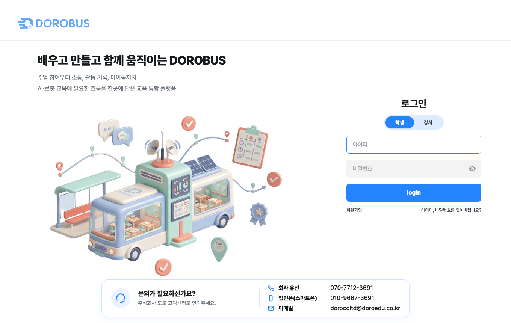
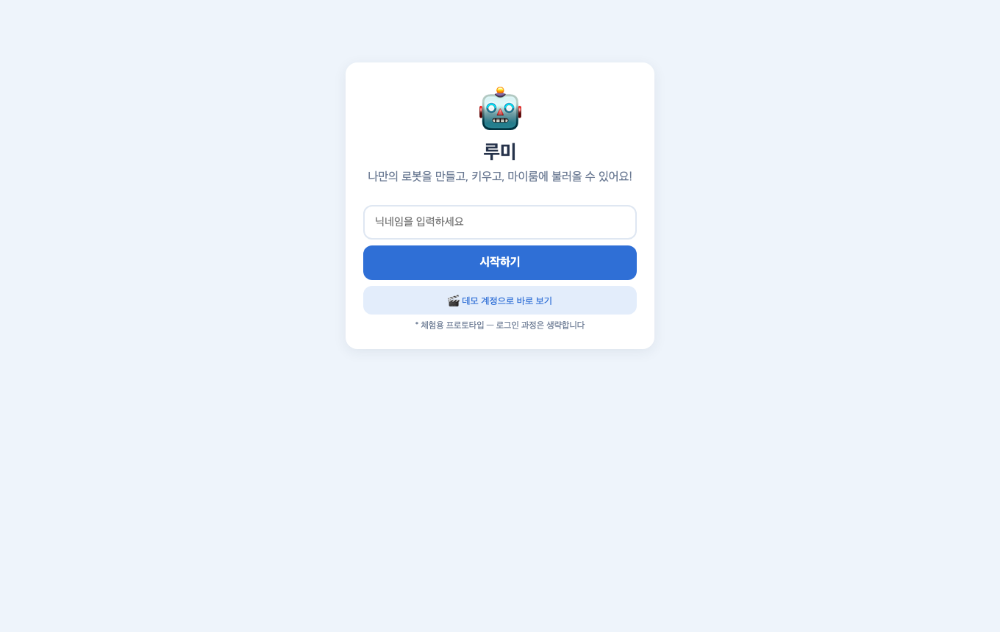
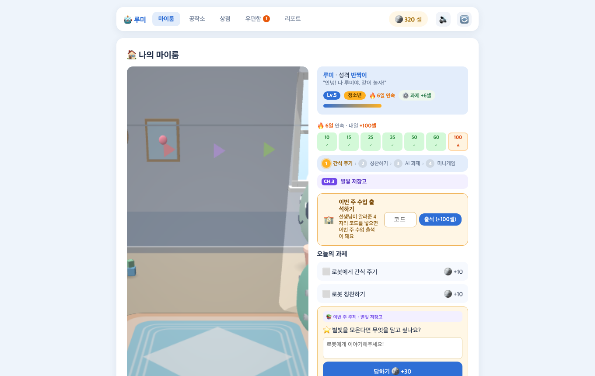
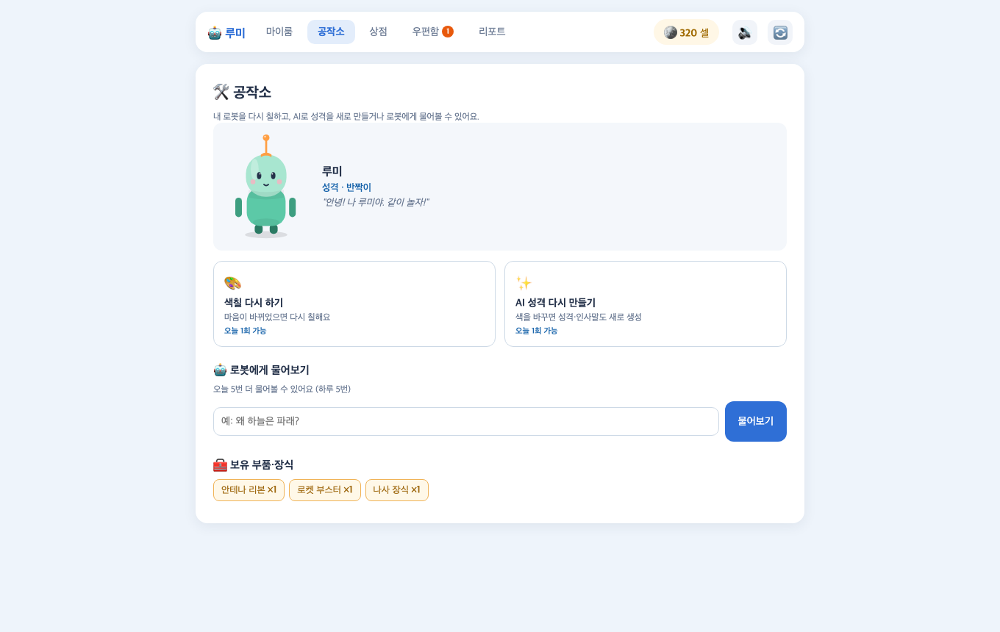
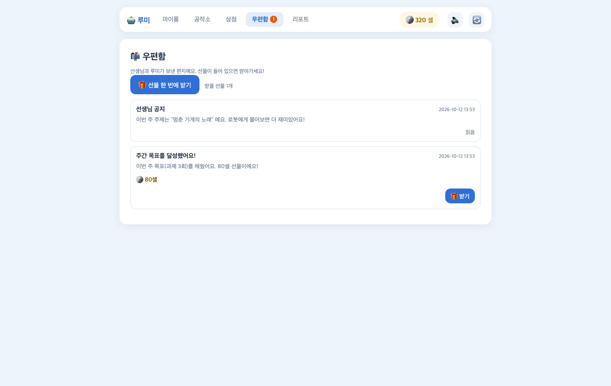
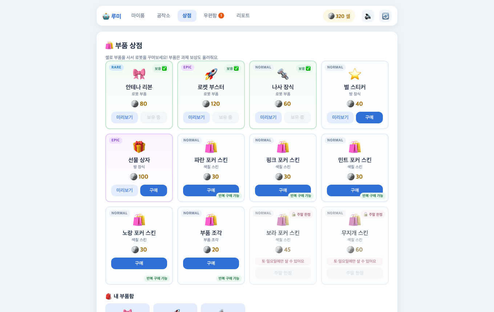
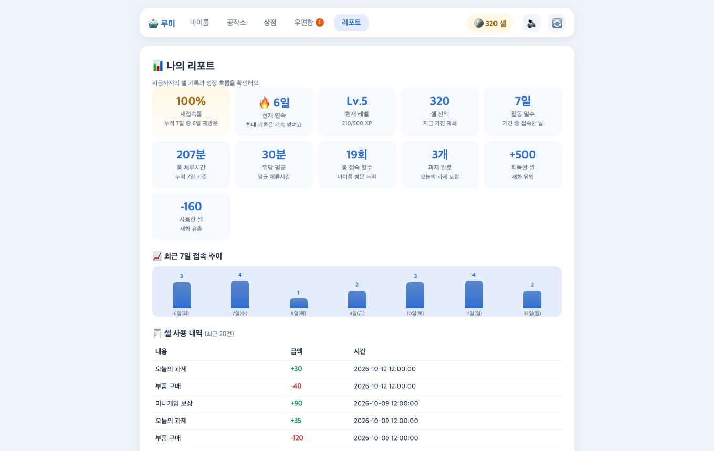

# 사례 조사 보고서 — "아이는 왜 다음 날 다시 여는가"

> ㈜도로 × 한양대 ERICA IC-PBL 2026-2학기
> 조사 목적: 우리 콘텐츠의 **재방문 설계**에 근거를 만들기 위함
> 조사 프레임: **① 재방문 장치 ② 보상 설계 ③ 아이 눈높이**
> 작성일: 2026-10-07 · **관찰 증거 보강: 2026-10-12** (DOROBUS 공개 페이지 + 우리 서비스 실측 촬영)
> 미확인 항목(로그인 후 화면·서비스별 최신 통계)은 6.3 에 ⬜ 로 남겨 두었습니다

---

## 1. 조사 목적

기업의 원래 문제는 **"수업이 없는 날 아이가 들어오지 않는다"** 입니다.
이 문제는 DOROBUS만의 것이 아니라 **모든 학습·놀이 서비스가 겪는 문제**입니다.
따라서 "다음 날 다시 열게 만드는 장치"를 이미 검증한 서비스들을 조사했습니다.

조사 질문:
1. 아이가 **다음 날 다시 여는 이유**를 무엇으로 만들었는가?
2. 보상은 **어떻게 설계**되어 있는가? (난이도·주기·확실성)
3. **아이 눈높이**에서 무엇이 다른가?

---

## 2. 조사 대상 선정

| 서비스 | 선정 이유 |
|---|---|
| **Duolingo** | "매일 돌아오게 하는 장치"를 가장 체계적으로 설계한 사례. 연속 학습(streak)의 교과서 |
| **Roblox / 마인크래프트 교육판** | **아이가 직접 만든다**는 축. 우리의 "로봇 만들기"와 같은 동기 구조 |
| **ZEP / 게더타운** | **공간에 머무는** 경험. 우리의 "마이룸"과 같은 축 |

---

## 3. 서비스별 분석

### 3.1 Duolingo — "끊기 아까운 연속"

| 항목 | 내용 |
|---|---|
| **재방문 장치** | **연속 학습 일수(streak)** 가 핵심. 하루라도 빠지면 0으로 돌아간다는 **손실 회피**가 동력 |
| | 연속 일수를 **달력으로 시각화**해 "채워진 칸"을 보여준다 |
| | 연속이 끊길 상황을 대비해 **아이템으로 보호**할 수 있게 한다(유료·무료) |
| | 주간 리그(순위)로 **다른 사람과의 비교**를 붙인다 |
| **보상 설계** | 하루 목표를 **작게** 잡는다 (5분). 진입 장벽을 낮춰 "일단 열게" 만든다 |
| | 보상은 **즉시·확실**. 미션 난이도와 무관하게 완료 자체를 축하한다 |
| | **연속 일수에 따라 보상이 커진다** — 7일·30일 등 이정표 |
| **아이 눈높이** | 캐릭터가 **과하게 칭찬**한다. 실패해도 벌하지 않고 격려 |
| | 알림(푸시)이 **죄책감이 아니라 애정** 톤 ("울고 있어요"식 표현은 논쟁이 되기도 함) |

**우리에게 준 것**
- ✅ **연속 방문(streak) + 7일 순환 보상** — 채택
- ✅ **연속 일수를 달력으로** — 채택 (7칸 달력, 내일 보상을 미리 표시)
- ✅ **하루 목표를 작게** — 채택 (과제 3개, 미니게임 각 1회)
- ❌ **손실 회피형 알림** — 제외 (아동 대상에서 심리적 압박이 될 수 있음)

> **우리 구현과의 차이**: Duolingo는 **"끊기 아까움"**이 동력이지만,
> 우리는 **"내일 받을 보상이 미리 보임"**을 동력으로 삼았습니다. 초등 저연령에서
> 손실 회피는 스트레스가 될 수 있다고 판단했습니다.

### 3.2 Roblox / 마인크래프트 교육판 — "내가 만든 것"

| 항목 | 내용 |
|---|---|
| **재방문 장치** | **자기 세계·자기 캐릭터에 대한 소유감**. 어제 만든 것이 오늘도 그대로 있다 |
| | 친구가 내 공간에 놀러 온다 → **보여주고 싶은 것**이 동기가 된다 |
| | "다음에 만들 것"이 계속 생긴다 (재료·설계도) |
| **보상 설계** | **창작 자체가 보상**. 외부 화폐 없이도 동기가 유지된다 |
| | 다만 게임 내 재화가 있으면 **희소 아이템**이 목표가 된다 |
| **아이 눈높이** | 실패가 없다. 부수고 다시 지어도 손해가 없다 |
| | 결과물을 **스크린샷으로 공유**하는 문화가 자연스럽다 |

**우리에게 준 것**
- ✅ **로봇에 대한 소유감** — 아이가 직접 색칠하고 이름을 짓는다
- ✅ **자랑하기(그림 저장)** — 채택. 만든 것을 보여주는 출구를 만들었다
- ✅ **"다음에 만들 것"** — 부품·스킨으로 계속 목표가 생기게 설계
- ✅ **실패 없음** — 색칠은 되돌릴 수 있고, 미니게임 실패는 "한 판만" 건너뛴다

### 3.3 ZEP / 게더타운 — "공간에 머무는 경험"

| 항목 | 내용 |
|---|---|
| **재방문 장치** | **약속된 만남**. "누가 거기 있다"는 기대가 접속을 만든다 |
| | 공간 자체가 콘텐츠 — 꾸미고, 이동하고, 모인다 |
| | 이벤트·행사가 **특정 시간 접속**을 만든다 |
| **보상 설계** | 외부 보상이 약하다. **사회적 상호작용 자체**가 보상 |
| **한계** | 사람이 없으면 **빈 공간**이 된다 → 초기 사용자 확보가 관건 |

**우리에게 준 것**
- ✅ **공간에 머무는 경험** — 마이룸에서 로봇이 살아 움직인다
- ⚠️ **사회적 요소는 최소한** — 랭킹(비동기 비교)만 넣었다.
  실시간 만남은 안전·운영 부담이 커서 이번 범위에서는 제외
- 📌 **시사점**: 마이룸이 "빈 공간"이 되지 않으려면 **로봇이라는 상주 존재**가 필요하다.
  우리는 그 역할을 AI 로봇이 담당한다.

---

## 4. 비교표

| | Duolingo | Roblox/MC교육 | ZEP/게더타운 | **루미(우리)** |
|---|---|---|---|---|
| 재방문 동력 | 연속 끊기 아까움 | 소유감·창작 | 사회적 만남 | **예고된 보상 + 소유감** |
| 연속 장치 | ✅ 강함 | ❌ | ❌ | ✅ 7일 순환 + 달력 |
| 소유/창작 | ❌ | ✅ 강함 | ⚠️ 공간 꾸미기 | ✅ 로봇 제작·성장 |
| 사회적 요소 | ⚠️ 리그 | ✅ 강함 | ✅ 핵심 | ⚠️ 랭킹만 |
| 보상 화폐 | ✅ 젬 | ⚠️ 게임별 | ❌ | ✅ 셀(기존 재화 활용) |
| 하루 목표 크기 | 작음(5분) | 자유 | 자유 | 작음(과제 3 + 게임 2) |
| 실패 처리 | 격려 | 없음 | 없음 | **한 판만 건너뜀** |
| 대상 연령 | 성인~아동 | 아동~청소년 | 청소년~성인 | **초등 고학년~중학생** |

---

## 5. 도출한 설계 원칙 4가지

| # | 원칙 | 우리 구현 |
|---|---|---|
| 1 | **하루 목표는 작게** — 진입 자체를 쉽게 | 과제 3개(클릭 2 + 작성 1), 미니게임 각 1회 |
| 2 | **보상은 예고한다** — 받기 전에 알게 한다 | 7칸 달력에 "내일 +35셀" 표시 |
| 3 | **내가 만든 것이 남는다** — 소유감 | 로봇이 마이룸에 상주, 성장 단계별로 외형 변화 |
| 4 | **실패로 좌절시키지 않는다** | 미니게임 실패는 그 판만 건너뜀, 색칠은 자유 |

**의도적으로 채택하지 않은 것**
- 손실 회피형 알림(연속 끊김 경고) — 아동 심리에 부담
- 실시간 사회적 만남 — 안전·운영 부담
- 외부 화폐 결제 — 미성년자 대상

---

## 6. DOROBUS 자체 조사 — 관찰 증거

### 6.1 실제 촬영 (2026-10-12)

| # | 이미지 | 확인한 사실 | 우리 설계에 미친 영향 |
|---|---|---|---|
| 1 |  | 로그인 화면이 **학생 / 강사 탭** 으로 분리. "배우고 만들고 함께 움직이는 DOROBUS" — 수업 참여부터 소통·활동·기록·마이룸까지 한곳에 모은 통합 플랫폼 | 사용자가 **학생 단위 계정**임을 확인 → 우리도 모든 데이터를 user_id 에 귀속 |
| 2 |  | 우리 서비스 — 닉네임만 입력하면 시작(로그인 과정 생략). 프로토타입 성격을 명시 | — |
| 3 |  | **3D 마이룸 + 내가 칠한 색 로봇 + CH·2 주제 배지 + Lv.5·6일 연속 + 수업 출석 카드** | 기대효과 ①②③ 을 한 화면에서 보여주는 구성 |
| 4 |  | 색칠 다시 하기 / AI 성격 재생성 / 로봇에게 물어보기 | 회사가 "가장 원한다"고 한 공작소 탭 + AI 모듈 |
| 5 |  | 수령형 보상(직접 열어야 받아짐) + 미수령 배지 | 우편함을 재방문 동기로 사용 |
| 6 |  | 부품·장식·스킨·조각 교환 + 보유함 | 셀 소비처 설계 |
| 7 |  | 재접속률·체류·셀 흐름·7일 추이가 **SQL 집계**로 표시 | W13 효과 검증 측정 도구 |

> 6-1 은 공개 페이지라 누구나 재현 가능합니다. **로그인 후 화면(내 수업·공작소 내부·마이룸 내부)은 체험 계정이 필요**하여 아래 ⬜ 항목으로 남겼습니다.

### 6.2 촬영 체크리스트 (체험 계정 필요)

| 화면 | 상태 | 비고 |
|---|---|---|
| 대시보드 (수업 현황·DIMC 카드) | ⬜ | 체험 계정 로그인 필요 |
| 내 수업 (실제 수업 카드) | ⬜ | "한양대 인공지능과 IC-PBL(lhs)" 확인했던 화면 |
| 공작소 (코딩·회로 / AI 챗봇 / 진로 / 시뮬레이션) | ⬜ | **회사가 가장 원한다고 한 탭 — 연결점 설명에 필요** |
| 미니게임 (타자 60초 카드) | ⬜ | 우리 미니게임과의 비교 근거 |
| 마이룸 내부 (3D·세계 채팅·상점 입점) | ⬜ | 우리 마이룸과의 차이점 설명 |
| 상점 (가챠 구조·스탬프 보드) | ⬜ | 우리 상점과의 차이점 설명 |

### 6.3 확인할 사항

- ⬜ **체험 기간 2026-12-25 종료** — 발표 전 재확인 필요(기업 확인 사항)
- ⬜ 로그인 후 화면 6종 촬영 (위 체크리스트) — **체험 계정으로 30분이면 완료**
- ⬜ 서비스별 최신 통계(DAU·매출) — 공개 자료 갱신 시 반영

## 7. 결론

> **"아이가 다음 날 다시 여는 이유"는 세 서비스 모두 '하루 목표가 작고, 보상이 예고되며,
> 내가 만든 것이 남아 있기 때문"이었습니다.**

우리는 이 세 가지를 다음처럼 구현했습니다.

| 원리 | 우리 구현 |
|---|---|
| 하루 목표가 작다 | 과제 3개 + 미니게임 2종 (하루 5분 내외) |
| 보상이 예고된다 | **7칸 연속 방문 달력에 내일 보상 표시** |
| 내 것이 남는다 | **로봇이 마이룸에 살고, 레벨에 따라 실제로 자란다** |
| + 보여주고 싶다 | **자랑하기(그림 저장) · 오늘의 랭킹** |

그리고 DOROBUS의 기존 자산(셀·상점·마이룸)을 **새로 만들지 않고 그대로 활용**해,
"다음 날 다시 올 이유"를 **기존 생태계 안에서** 만들었습니다.

---

*본 보고서의 관찰 증거는 2026-10-12 재촬영분입니다. 로그인 후 화면 6종은 체험 계정 촬영분으로 보강 예정(6.2 체크리스트).
본 보고서의 서비스 분석은 공개된 서비스 동작 방식에 대한 것으로, 구체적 수치 인용 시에는
출처와 확인 일자를 함께 기재하십시오.*
